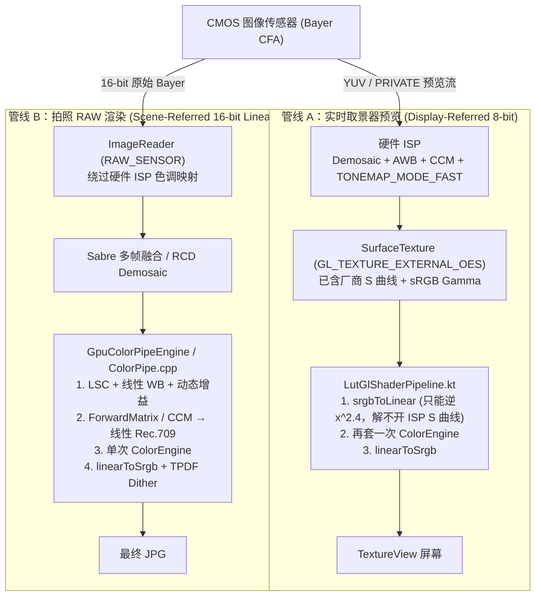

# 无 Log/LUT 默认色彩渲染引擎修复方案（修订版 v2）

> [!IMPORTANT]
> 本文档为架构与数学级技术方案，不直接修改代码。所有结论基于当前仓库 `ColorPipe.cpp`、`GpuColorPipeShader.h`、`LutGlShaderPipeline.kt`、`CameraHardwareStreamController.kt` 的真实实现（行号已按本 checkout 核对）。

## 本次修订相对 v1 的变更

| # | v1 的问题 | v2 的处理 |
|---|---|---|
| 1 | 全文混用「Default 引擎」与「Mode 1」，读者无法判断默认引擎是哪一个 | 新增第 1 节，用代码证据固定 **Default = Mode 2 (Sony Uchimura)**，并在第 6 节说明 Mode 1 不是默认引擎 |
| 2 | 修复 1 给出 1A / 1B 两条并列路线 | **1B 定案**，1A 降级为能力探测失败时的运行时回退（4.1） |
| 3 | 修复 3 与思路 A 读起来像二选一 | 明确为 **必修 + 可选风格层**，可叠加（第 5 节） |
| 4 | 修复 5 与思路 B 的关系未交代 | 明确为 **真互斥，二选一**；采用思路 B，修复 5 不采用（第 6 节） |
| 5 | 修复 5 声称「同样套用修复 3 的 safe_scale」 | **删除该条**：luma 域保护不得施加于 per-channel 输出（不变量 I2） |
| 6 | 修复 4 与修复 5 的部分数值经复算不成立 | 修复 4 数值订正；修复 5 核验记录见附录 A |
| 7 | 各条修复平铺，没有执行顺序 | 重组为 Stage 0 / 1 / 2 / 待定（第 4~7 节） |

---

## 0. 决策摘要

| 决策点 | 结论 |
|---|---|
| 取景器预览对齐 | **1B**：`TONEMAP_PRESET_CURVE_SRGB` + 能力探测；不支持时运行时回退 1A |
| Default 引擎是哪个 | **Mode 2 = Sony Uchimura** |
| Mode 2（Default）怎么升 | 修复 3 **必修**（修削顶 bug）+ 思路 A **可选**（密度风格层） |
| Mode 1 怎么升 | **思路 B**（per-channel inset 管线）；修复 5 **不采用** |
| Mode 0 | 修复 4（黑位，必修） |
| Mode 3 | 修复 6（可选，本版不做） |
| 思路 C | 延后，与思路 A 不在同一版上线 |
| 执行顺序 | Stage 0（一致性）→ Stage 1（Mode 2）→ Stage 2（Mode 1） |

**实施状态**：本分支按 Stage 0 → Stage 1 → Stage 2 依次落地，配套单测 `ColorEngineMathTest`（15 例）：一部分锁定期望数值与第 8 节验收项，另一部分在源码层比对三处实现的共享常数（见第 8 节说明）。`density_reduction` 按计划保持 `0.0` 关闭。

---

## 1. 事实基线：Default 到底是哪个引擎

v1 全文用「Default 引擎」直接指代，却从未说明它是四个槽位里的哪一个。代码给出的答案很明确：

**Default = Mode 2 = Sony Uchimura**，三处一致：

| 位置 | 内容 |
|---|---|
| [`DarkbagPreferences.kt:59`](../app/src/main/java/top/maary/darkbag/repository/DarkbagPreferences.kt#L59) | `val colorEngineMode: Int = 2` |
| [`RenderRecipe.kt:19`](../app/src/main/java/top/maary/darkbag/pipeline/model/RenderRecipe.kt#L19) | `val colorEngineMode: Int = 2` |
| [`PreferenceKeys.kt:296`](../app/src/main/java/top/maary/darkbag/repository/PreferenceKeys.kt#L296) | 标签字面量 `"Sony Uchimura (GT7, Default)"` |

（[`ImageRepository.kt:529`](../app/src/main/java/top/maary/darkbag/repository/ImageRepository.kt#L529) 中 `json.optInt("color_engine_mode", 0)`、以及 [`ColorProcessor.kt`](../app/src/main/java/top/maary/darkbag/processor/ColorProcessor.kt) 若干形参的 `= 0`，都是历史图片反序列化与内层 API 的兜底默认值，不是用户默认引擎。）

### 四个槽位与文档条目的对应关系

| 槽位 | 用户可见名称 | 是否 Default | 本方案动它的条目 |
|---|---|---|---|
| 0 | Khronos PBR Neutral | 否 | 修复 4 |
| 1 | Natural Filmic (Leica/Hasselblad) | 否 | **思路 B**（修复 5 不采用） |
| 2 | Sony Uchimura | **是** | **修复 3 + 思路 A** |
| 3 | Legacy ACES Filmic | 否 | 修复 6（本版不做） |

> **由此可得：修复 5 / 思路 B 不改变用户开箱即见的效果。**决定「默认观感」的是 Mode 2 那一行。这也意味着 Mode 2 的改动风险最高，必须放在一致性修复之后、单独验收。

---

## 2. 管线确认：为什么取景器比成片更黑

取景器预览流与拍摄 RAW 渲染是两条在硬件源头就分叉的管线。



**结论**：无 Log/LUT 时，取景器经历「ISP 1 次曲线 + 软件引擎 1 次曲线」共 2 次映射；RAW 成片只有 1 次。这是「取景器反差更重、暗部更黑」的根因。修复 1 解决它。

---

## 3. 三条硬性不变量

后续任何实现都必须满足这三条，否则会重新引入同类问题。

### I1：同一引擎内不得叠加两层 luma-scale 高光保护

一次色调映射只能有一层「按亮度/峰值缩放」的高光收缩。两层叠加会产生双重退饱和，高光变灰泥。

### I2：luma 域保护不得施加于 per-channel 已映射的输出

`min(luma_scale, peak_scale)`、`mapped_luma > 0.85` 这类判据都以「输入 luma 与输出 luma 一一对应」为前提。per-channel 映射后该前提失效：三通道各自压缩后重新合成的 luma 已不是原 luma，此时再做 luma 缩放既无物理意义，又会与通道交叉退饱和重复计数。

**因此：修复 3 的 `safe_scale` 只属于 Mode 2（以及未来任何 luma 域引擎），不得进入 Mode 1 的 per-channel 路径。**

### I3：任何 grade 必须三处同源实现

1B 之后取景器成为四大引擎的权威显示，因此每个像素级改动必须在三处用**逐字等价**的数学实现：

| 位置 | 作用 |
|---|---|
| `app/src/main/cpp/ColorPipe.cpp` | CPU 全分辨率 JPG（真机主路径） |
| `app/src/main/cpp/gpu/GpuColorPipeShader.h` | GPU 最终渲染 |
| `app/src/main/java/top/maary/darkbag/processor/LutGlShaderPipeline.kt` | 取景器预览 |

**当前这三处已经漂移**，这是 Stage 0 的一部分（见 4.2），也是「不要只改一处」的实证：

| 位置 | 肩部系数 `CP` | 是否含增益扩展 | 高光退饱和判据 |
|---|---|---|---|
| `ColorPipe.cpp` → `uchimura_scalar` | `-C2 / (P * max(1, gain*0.75))` | 是 | `mapped_luma > 0.85` |
| `GpuColorPipeShader.h` → `uchimuraScalar` | `-C2 / P`（硬编码） | **否** | `mappedLuma > 0.85` |
| `LutGlShaderPipeline.kt` → `uchimuraScalar` | `-((a*P)/(P-S1)) / P`（等价于 `-C2/P`） | **否** | `mappedLuma > 0.85` |

---

## 4. Stage 0：管线一致性（不改变任何审美取向）

本阶段只修正确性，验收标准是「预览与成片同一条曲线」，不含主观审美判断。

### 4.1 修复 1：取景器解除双重 Tone Mapping（1B 定案）

**目标文件**：`CameraHardwareStreamController.kt`、`LutGlShaderPipeline.kt`

#### 4.1.1 主路径：1B

在 `CameraHardwareStreamController.applyFocusAndExposureSettingsToRequest` 里（预览与静态拍照共用，因此静态拍照仍保留 `TONEMAP_MODE_FAST`）将：

```kotlin
request.set(CaptureRequest.TONEMAP_MODE, CaptureRequest.TONEMAP_MODE_FAST)
```

改为在设备支持时使用 preset curve：

```kotlin
val tonemapModes = characteristics.get(CameraCharacteristics.TONEMAP_AVAILABLE_TONE_MAP_MODES)
val supportsPresetCurve = tonemapModes?.contains(CaptureRequest.TONEMAP_MODE_PRESET_CURVE) == true
if (supportsPresetCurve) {
    request.set(CaptureRequest.TONEMAP_MODE, CaptureRequest.TONEMAP_MODE_PRESET_CURVE)
    request.set(CaptureRequest.TONEMAP_PRESET_CURVE, CaptureRequest.TONEMAP_PRESET_CURVE_SRGB)
} else {
    request.set(CaptureRequest.TONEMAP_MODE, CaptureRequest.TONEMAP_MODE_FAST)
}
```

**必须做能力探测**：当前仓库没有任何 `TONEMAP_AVAILABLE_TONE_MAP_MODES` 查询，直接写死 `PRESET_CURVE` 在不支持的机型上属于未定义行为（可能整条 request 被拒或静默回退），现场表现为预览色彩异常且无任何日志线索。

**为什么 1B 是对的**：`PRESET_CURVE_SRGB` 让硬件只做标准 sRGB OETF，不再叠加厂商 S 曲线，于是 `srgbToLinear` 能真正反演出准线性信号，四大引擎的实时预览才有意义。

**附加收益（v1 未提及）**：`uWbPreviewMatrix` 当前被作用在 `srgbToLinear` 之后的「伪线性」数据上（其构造是 CAT16 + sRGB↔XYZ，见 `LutGlShaderPipeline.computeWbPreviewMatrix`）。在 S 曲线污染下这个矩阵物理上不成立；1B 之后信号真线性，它才第一次正确。

**两个必须知道的副作用**：

- 同一个 preview repeating request 上还挂着 `analysisImageReader`（`YUV_420_888`），其消费方用 `Y > 240` 统计过曝比并喂给运动检测。把 ISP 曲线换成标准 sRGB OETF 后，这个阈值的含义被隐式重标定，过曝提示与运动检测的输入会跟着变。不是 bug，但需要知道。
- Google 对 `TONEMAP_MODE_PRESET_CURVE` 的说明是「generally expected to be very slow」，本意是给静态拍摄用。部分机型在 30/60fps 预览下可能掉帧，所以 `applyPreviewToneMapPolicy` 会记录一次实际生效的 mode，便于现场定位。

**三个调用点缺一不可**：首次起流（`onConfigured` 里的 preview request）、后续刷新（`updateCamera2RepeatingRequest`）、多摄预览（`applyPreviewFocusAndExposureSettings`）。只改其中一处会表现为「开相机第一帧仍是双重曲线，动一下控件才切换」的影调跳变——这是实现阶段被评审抓出的漏点。

#### 4.1.2 回退：不支持的机型保持原行为（不落 1A 的 shader 旁路）

能力探测失败时保持 `TONEMAP_MODE_FAST`，渲染引擎照旧叠加——**即完全维持改动前的行为**。

> **这里偏离了 v1 的 1A。**v1 建议在回退路径上让 shader 只做白平衡预览、不再叠加 Tone Mapper。实现时没有采纳，原因是一个 v1 没考虑到产品后果：跳掉引擎之后，取景器里四个引擎会长得**一模一样**，用户切换 Mode 0~3 时看不到任何反馈。相比之下，回退机型上「预览偏重一点」是更轻的代价。
>
> 1A 若要真正上线，前提是先给这些机型一个明确的 UI 提示（例如预览右下角标注「引擎仅作用于成片」），否则就是用一个静默的观感退化换掉另一个。这条留作后续工作。

回退路径下，取景器与成片的影调**不会**一致，这是硬件约束而非实现缺陷，UI 与文档都不应承诺二者一致。

#### 4.1.3 验收：灰卡响应曲线叠加

拍灰卡，取 3~5 档曝光（含 −2 EV / 0 / +2 EV），把预览帧与同条件 RAW 成片的传递曲线画在同一张图上：

- 全程重合 → 1B 成立。
- **仅中间调重合、趾部与肩部分开** → 厂商 ISP 在 preset curve 之外仍施加了局部色调映射。此时必须承认现实：改为只在中间调承诺一致，或接受取景器是「近似预览」。

这一项比任何主观评价都更能判定 1B 的实际收益，**必须在 Stage 0 结束时给出结论**。

### 4.2 修复 2：三处 Uchimura 数学对齐（含增益扩展）

**目标文件**：`GpuColorPipeShader.h`、`LutGlShaderPipeline.kt`（对齐 `ColorPipe.cpp`）

1. **GPU 端补上动态增益肩部**。`GpuColorPipeShader.h` → `uchimuraScalar` 里写死的 `CP = -C2 / P` 改为与 CPU 一致：

   ```glsl
   float CP = -C2 / (P * max(1.0, uDigitalGain * 0.75));
   ```

   `uDigitalGain` uniform 已存在（`GpuColorPipeEngine.cpp` 里 `totalGain = baseGain * expGain`），无需新增。

   **一个容易漏掉的等价性**：CPU 侧信号是 `norm = raw/65535 * gain * exp_gain`，所以引擎必须收到 `gain * exp_gain` 才和 GPU 的 `totalGain` 对齐。只传 `gain` 会让曝光补偿一拖就分叉——这是实现阶段被评审抓出来的，已修正。

2. **取景器端同样补增益（v2 新增）**。预览路径的对应量是 `uPreviewGain`，它在引擎之前就乘进了线性值。为保证 I3 逐字等价，`uchimuraScalar` 需接受增益参数并使用 `max(1.0, uPreviewGain * 0.75)`。否则 ZSL 预览补亮时预览与成片的肩部再次分叉。

3. **移除 CPU 的 `50000` 硬编码前置 Knee**。`ColorPipe.cpp` → `process_and_save_image` 在 `targetLog == 0 && lut.size == 0` 时于 `50000.0f`（76.3%）处提前做 `excess / (excess + range)` 压缩，把本应交给引擎肩部处理的高光区间提前压掉。改为对齐 `GpuColorPipeShader.h` 的 `rawMax > 0.98` 满井防品红保护，把 `[0.76, 1.0+]` 完整交还色彩引擎。

> **注意**：本项不改变任何曲线形状，只消除实现分叉。它应当在 Mode 2 的任何审美调整**之前**完成，否则无法判断观感变化来自哪里。

### 4.3 修复 4：Mode 0 摄影级黑位

**目标文件**：`ColorPipe.cpp:555-560`（及 GPU / 预览同名实现）

**问题**：`offset = (x < 0.08f) ? (x - 6.25f * x * x) : 0.04f` 照搬 3D 渲染规范的 `0.04` 线性黑位扣减，把 `<0.08` 区域的原点斜率压为 0。在已扣过传感器 BlackLevel 的 RAW 管线上造成死黑。

**修复**：

```cpp
// 摄影级 PBR Neutral：仅消除极暗部 <= 0.012 的热噪底灰，保留暗部层次与原点非零斜率
float x = std::min(color.r, std::min(color.g, color.b));
float offset = (x < 0.012f) ? (0.5f * x - 20.8333f * x * x) : 0.003f;
```

（系数自洽性：阈值处 `0.5*0.012 - 20.8333*0.012^2 = 0.003`，与分段常量 0.003 连续。）

**实现时补的一处耦合**：参考规范里 `startCompression = 0.8 - 0.04`，那个 `0.04` 就是黑位偏移量。偏移量改成 0.003 后若仍写死 `0.76`，肩部会比设计提前 0.04 开始压缩——正是修复 2 要消除的「提前吃掉高光」。因此实现里 `startCompression = 0.8 - kBlackOffset = 0.797`。这也是上表 1.00 行是 `0.9536` 而不是 `0.9987` 的原因：纯白仍会经过肩部压缩，只是不再被黑位偏移和提前肩部叠加两次。

**订正 v1 的数值**：v1 称修复后线性 `0.01` 的 sRGB 输出为 `0.056`，复算为 **`0.079`**（v1 的 `0.457` @ 线性 0.18 是对的）。

| 线性输入 | 现状 sRGB | 修复后 sRGB |
|---|---|---|
| 0.01 | 0.0081（死黑） | **0.0791** |
| 0.18 | 0.4100（−0.36 EV） | 0.4578（−0.02 EV） |
| 0.50 | 0.7084 | 0.7334 |
| 1.00 | 0.9401 | 0.9536 |

---

## 5. Stage 1：Mode 2（Default 引擎）

**这一阶段决定用户开箱即见的效果。**注意修复 3 与思路 A 不是二选一：一个是修 bug（必修），一个是加风格（可选）。

### 5.1 修复 3（必修）：根治 Pure-Luma 高饱和单通道硬削顶

**问题根源**：`scale = mapped_luma / luma` 直接乘到 `R, G, B`。当 `luma_scale > 1` 时峰值通道被放大越过 1.0 后硬 `clamp`。

**v1 举例订正**：v1 用的 `(0.9, 0.1, 0.05)` 复算实际输出 `0.939`，**并不削顶**。真正削顶的例子是输入峰值恰为 1.0 的饱和红：

```
c = (1.0, 0.05, 0.02) → luma = 0.250, mapped_luma = 0.257
scale = 1.030 → out = (1.030, 0.051, 0.021) → R 被削到 1.0（色相偏移 + 高光死白）
```

**目标文件**：三处 `apply_sony_uchimura` / `applySonyUchimura`

**修复**：

```cpp
Vec3 apply_sony_uchimura(Vec3 c, float gain) {
    float luma = 0.2126f * c.r + 0.7152f * c.g + 0.0722f * c.b;
    float peak = std::max({c.r, c.g, c.b});
    if (peak <= 0.00001f) return {0.0f, 0.0f, 0.0f};

    float mapped_luma = uchimura_scalar(luma, 1.0f, 1.25f, 0.22f, 0.40f, 1.33f, 0.0f, gain);
    float mapped_peak = uchimura_scalar(peak, 1.0f, 1.25f, 0.22f, 0.40f, 1.33f, 0.0f, gain);

    // 1. 基础比例缩放：由 Luma 驱动暗部与中调反差，但峰值缩放不得让峰值超过 mapped_peak
    float luma_scale = (luma > 1e-5f) ? (mapped_luma / luma) : 1.0f;
    float peak_scale = mapped_peak / peak;
    float safe_scale = std::min(luma_scale, peak_scale);
    Vec3 out = { c.r * safe_scale, c.g * safe_scale, c.b * safe_scale };

    // 2. 基于实际峰值压缩量的物理平滑退饱和（替代死板的 mapped_luma > 0.85）
    float compression = std::max(0.0f, peak - mapped_peak);
    float desat = 1.0f - 1.0f / (0.20f * compression + 1.0f);
    float out_luma = 0.2126f * out.r + 0.7152f * out.g + 0.0722f * out.b;
    float target_white = std::max(out_luma, mapped_peak);

    out.r = std::clamp(out.r + (target_white - out.r) * desat, 0.0f, 1.0f);
    out.g = std::clamp(out.g + (target_white - out.g) * desat, 0.0f, 1.0f);
    out.b = std::clamp(out.b + (target_white - out.b) * desat, 0.0f, 1.0f);
    return out;
}
```

**为什么数学上不可能再削顶**：`uchimura_scalar` 的输出恒在 `(S1, P)` 内，即 `mapped_peak < 1.0` 严格成立；于是 `peak * safe_scale <= peak * peak_scale = mapped_peak < 1.0`。这不需要任何事后 `clamp` 兜底。

**已知取舍（须在验收时确认可接受）**：当 `luma_scale > peak_scale` 时（典型为明亮高饱和色），输出亮度会低于 luma 映射本应给出的值——例如上例 `(1.0, 0.05, 0.02)` 退饱和前 luma ≈ 0.221、退饱和后 ≈ 0.236，低于输入 0.250。这是「高饱和自带光学密度」的物理表现，与思路 A 方向一致，但对肤色与高饱和红衣需要目视确认没有「发闷」。中灰与低饱和区与原版逐像素等价。

### 5.2 思路 A（可选）：减法密度感

**定位**：风格层，不是路线选择。与修复 3 叠加，不冲突。

**实现**（挂在 Tone Mapper **之后**）：

```glsl
// chroma in [0,1]
float peak   = max(color.r, max(color.g, color.b));
float trough = min(color.r, min(color.g, color.b));
float chroma = (peak > 1e-4) ? (peak - trough) / peak : 0.0;

// density_reduction 为唯一可调常量，默认 0.0（即关闭）
float densityFactor = 1.0 - density_reduction * (chroma * chroma);
color *= densityFactor;
```

**为什么必须放在 Tone Mapper 之后**：放在之前会先压低 luma 再进曲线，肩部压缩量随之改变，密度效果被曲线斜率部分抵消，且 `uDigitalGain = 2~4` 时行为不可预测；放在之后才是纯粹的「印刷密度」语义（中性色不动，饱和色变沉）。

**参数策略**：`density_reduction` 是**唯一**可调常量，默认 `0.0f` 上线，用实拍 A/B 在 `0.08 / 0.10 / 0.12` 三点决定。不要在首发版本里凭主观选一个值。

**副作用边界（已订正）**：中性灰 `chroma = 0` 完全不受影响；但线性空间里的暖肤色实际落在 `chroma ≈ 0.55`（HSV 饱和度），不是本节早期估计的 0.35。`0.12 * 0.55² ≈ 3.7%` 的压暗是能被看出来的，单测 `density leaves neutrals untouched and calms saturated colours` 把这个数钉住了。这正是 `density_reduction` 必须保持 0.0 上线、并优先在肤色样张上做 A/B 的原因。

---

## 6. Stage 2：Mode 1（真正需要做决定的地方）

### 6.1 为什么这里是真互斥

修复 5 与思路 B 都要把 Mode 1 的色调映射**整个替换**，且替换后属于不同的数学域：

| | 修复 5 | 思路 B |
|---|---|---|
| 域 | luma 域：`f(Y)` + 整体缩放 RGB | per-channel 域：三通道各自映射 |
| 高光退饱和机制 | `min(luma_scale, peak_scale)` + 压缩量驱动 | 通道交叉自然趋向白 |
| 色彩比例 | 保持不变（缩放） | 「数字味」的来源被消除 |

同一段代码不可能同时是这两种。**选 B 就删掉 5，反之亦然。**

### 6.2 决定：采用思路 B

**理由**：修复 5 会让 Mode 1 变成「修好了的 Mode 2」——两者都是 luma 域 + 缩放，性格同源，用户切过去只会觉得「软了一点」。要满足「每个引擎拥有独立且高级的物理性格」的目标，只有 per-channel + inset 能在数学层面给出不同的高光行为。

**实现结构**（Blender 4.x AgX 的核心思想，代价是两个 3×3 矩阵乘法）：

1. **Inset**：进入 1D 曲线前乘 `M_inset`，把极端纯色向白点微收（约 12%），并微调红/蓝主轴角度以抵消 Abney 效应（高光变亮时人眼觉得红偏品红、蓝偏紫的生理错觉）。
2. **Per-Channel 1D S 曲线**：对三通道独立运行一条干净的 S 曲线。因为已 inset，不会出现 ACES 式的黄/青偏，且天然获得高光退饱和。
3. **Outset**：曲线后用 `M_outset` 恢复中调色彩张力，保留高光柔和退饱和。

### 6.3 思路 B 的实施约束（不满足会退化成假 AgX）

1. **白点必须重标定**。per-channel 曲线的白点不能是 1.0。若白点取 1.0，纯红 `(1,0,0)` 几乎原样通过（以 v1 那组系数为例只能映射到 `(0.985,0,0)`）——**毫无肩部压缩，也就不可能有通道交叉退饱和**，得到的只是一个「长得像 AgX 但没有 AgX 行为」的东西。参照 AgX，白点需落在约 **16:1（≈ +4 EV）**，使 1.0 在饱和之前就进入肩部。
2. **不得叠加 `safe_scale`**。违反 I2。思路 B 的防爆由 inset + per-channel 肩部结构性提供。
3. **不得叠加 `mapped_luma > 0.85` 退饱和**。违反 I1。
4. **中灰锚点必须复核**。neutral 输入 `(g,g,g)` 经 per-channel 后仍须回到 `g`，否则白平衡会随亮度漂移。
5. **三处同源**（I3）。inset/outset 矩阵与曲线必须在 CPU / GPU / 预览各实现一次并逐值对齐。

6. **实际实现（本分支）**：inset 采用 Blender 4.x AgX 的矩阵（行和为 1，中性轴直通）；outset 取 inset 的**精确逆**，而不是另一组手工常数——这样中性轴逐位往返、可被单测钉死。逐通道曲线取 `f(x) = N / (N + 1)`、`N = x·(2.3134378·x + 0.8030934)`，按 `f(0.18) = 0.18` 与 `f'(0.18) = 1.10` 两个约束解析求解：单调、渐近恰好 1.0、原点斜率 0.803（一个柔和 toe）。
   注意一个实现细节：`f(x)` 的向量形式 `n / (n + 1)` 在 GPU 上是三通道一次算完，无需 `if` 分支，也不存在除零（`n >= 0`）。

7. **越界归一（outset 之后）**：outset 含负的次对角项，因此即使每个映射通道都 ≤ 1，极端饱和高光仍可能把某个通道推过 1（实测最大约 1.174）。此处在 outset 之后按 `out *= 1/peak` 归一——**以原点为锚**，所以色相与通道比例不变，峰值精确落在 1.0，之后才做 `clamp`。注意这不是「向白收缩」：`1 + (out-1)/peak` 这种以 1.0 为锚的写法在 `x = peak` 处得到 `2 - 1/peak > 1`，主通道照样被切，是实现阶段被评审抓出来的错误公式。
   Mode 1 因此共有三层高光机制，触发条件互不重叠：inset（线性、全幅）、per-channel 肩部（每通道、渐近 1.0）、越界归一（仅 `peak > 1`）。三层都不是 luma 判据，所以不违反 I2。

### 6.4 修复 5：不采用

`ColorPipe.cpp` 中 Mode 1 当前的 `A=2.35, B=0.02, C=2.35, D=0.70, E=0.12` 的**问题诊断是正确的**（中灰偏亮约 +0.46 EV，白点只到 0.880 sRGB），但 v1 给出的替代系数不可用。复算见附录 A：那组系数会让 18% 中灰输出 `0.709` sRGB（约 **+1.36 EV**），比现状更偏亮。

因此本方案不采用修复 5。若未来仍想要一条 luma 域备选曲线，须用数值拟合（锚定 `f(0.18)=0.18`、`f(1.0)≈0.985`、`f(0.01)≈0.0058`）反解系数并逐点验证，不得手工凑数。

---

## 7. 本版不做的事

### 7.1 修复 6：Mode 3 Legacy ACES

保留为怀旧选项。若要做，只做两件事：文案上明确其为「高反差胶片风格」；前置 `0.80` 曝光补偿抵消 Narkowicz 公式自带的 `+0.63 EV` 提亮。可选混入 30% luma 守恒分量减轻六相色偏。**本版不做**，避免与 Stage 1 的观感评估相互干扰。

### 7.2 思路 C：Bell-Curve Vibrance

**延后**。它和思路 A 都在塑形饱和度，只是作用域不同（C 动中调中低饱和，A 动高饱和与高光）。首发同时上线等于装入两个互不知情的饱和度塑形器，混合光下的肤色最易翻车。等 Stage 1 的 `density_reduction` 定稿后再评估。

若将来要做，顺序固定为：**vibrance → tone map → density**。

---

## 8. 验收与质量门

| 阶段 | 验收项 |
|---|---|
| Stage 0 | 灰卡曲线叠加（4.1.3）；`threeSiteConstantsMatch` 源码级三处常数一致性（含 mat3 转置检查）；`./gradlew testDebugUnitTest --rerun-tasks` 全绿；`:app:buildCMakeRelease` 零错误 |
| Stage 1 | Mode 2 高饱和红/蓝 `max(R,G,B) < 1.0` 恒成立（可单测）；中灰与肤色对比原版逐像素等价（低饱和区）；`density_reduction` A/B 样张归档 |
| Stage 2 | Mode 1 中灰无漂移；高光无硬削顶；preview / CPU / GPU 三处同源截图对比 |

**回归红线**：任何阶段都不得让 `TONEMAP_AVAILABLE_TONE_MAP_MODES` 探测缺失（4.1.1）；不得在 per-channel 路径上出现 `safe_scale`（I2）。

**关于单测的边界（诚实说明）**：`ColorEngineMathTest` 里的数值用例是测试内维护的参考实现，它锁的是「期望数学」，不是产品代码实际执行的那一份——单测跑在 JVM 上，不会真的调用 C++ 或 GLSL。真正防「改一处漏两处」的是同文件里的 `threeSiteConstantsMatch`：它读取 `ColorPipe.cpp`、`GpuColorPipeShader.h` 与 `FRAGMENT_SHADER_SRC` 源码，比对 inset/outset 矩阵（**按列主序逐一元素比，能抓出转置错误**）、Uchimura 曲线常数、PBR 的 `desaturation = 0.15`、`1.0 / peak` 归一、`kColorDensityReduction`，以及压缩退饱和常数是否三处一致。这比声称「三处数值一致性单测」更准确。

---

## 附录 A：v1 数值核验记录

### A.1 修复 5 系数不可用

`f(Y) = Y(AY+B) / (Y(CY+D)+E)`

| 输入 Y | 现状 (2.35/0.02/2.35/0.70/0.12) | v1 声称 | v1 系数实算 (1.65/0.04/1.45/0.22/0.045) |
|---|---|---|---|
| 0.01 | linear 0.0034 / sRGB 0.044 | sRGB 0.068 | linear 0.0119 / **sRGB 0.112** |
| 0.18 | linear 0.2475 / sRGB 0.535 | linear 0.181 / sRGB 0.462 | linear 0.4610 / **sRGB 0.709** |
| 0.50 | linear 0.5650 / sRGB 0.777 | sRGB 0.758 | linear 0.8357 / **sRGB 0.924** |
| 1.00 | linear 0.7476 / sRGB 0.880 | sRGB 0.985 | linear 0.9854 / sRGB 0.994 |

**两处问题**：

1. v1 在「线性输出」与「sRGB 输出」两个量之间混用且未标注，`0.985` 是线性值而非 sRGB 值，`0.462` 恰好是「线性 0.181 的 sRGB 编码」——两者互不自洽。
2. 按 v1 系数实算，18% 中灰的 sRGB 输出为 `0.709`（+1.1 EV），比它要修的现状 `0.535`（+0.46 EV）**更偏亮 0.9 EV**。该组系数不可用。

### A.2 修复 3 举例订正

`(0.9, 0.1, 0.05)` → `luma = 0.266`、`mapped_luma = 0.278`、`scale = 1.044` → 输出 `(0.939, 0.104, 0.052)`，**无削顶**。v1 以此为例说明硬裁切，例子不成立。已改用 `(1.0, 0.05, 0.02)`。

### A.3 修复 4 数值订正

v1 称线性 `0.01` 修复后 sRGB 为 `0.056`，复算为 `0.0791`。详见 4.3 表。

### A.4 事实补充（v1 未记载）

- 仓库内不存在 `TONEMAP_AVAILABLE_TONE_MAP_MODES` 查询（改动前全仓只有 `applyFocusAndExposureSettingsToRequest` 里一行 `TONEMAP_MODE_FAST`），1B 的能力探测需从零新增。
- GPU 与预览两处的 Uchimura 均无增益扩展，CPU 有，三处已漂移（见第 3 节 I3 表）。
