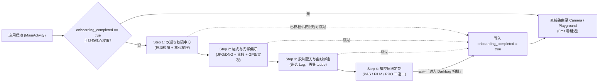

# Darkbag 首次安装引导流程设计规范 (First-Install Onboarding Design)

> **版本**：v1.1 (根据设计评审微调更新)  
> **设计语言**：Bento Matrix & Material 3 Expressive Design System (`AGENTS.md` Invariant 5)

---

## 1. 核心设计原则与微调基准 (Core Principles & Refinements)

根据产品定位与用户体验审查，本次设计遵循以下 5 大核心准则：
1. **品牌专有名词规范**：Darkbag 即为 **Darkbag**，不使用中文翻译（杜绝“暗袋相机/暗袋出片”等冗余生硬译名）。
2. **严谨的硬件能力表述**：移除任何设备不确定性的绝对硬件标签（如 `RAW16`）。不同 Android 机型的传感器 RAW 输出深度（RAW10 / RAW12 / 包含在 16-bit 容器中的 RAW_SENSOR）各异，引导页不作超出硬件事实的保证。
3. **消除内部工程参数负担 (Zero Engineering Clutter)**：
   - **Color Engine（色彩映射引擎）** 属于底层色调映射算法，统一使用最优出厂默认值（`Sony Uchimura GT7` 电影感高光滚降），**不要求用户在引导期做晦涩的技术选择**。
   - **移除 Hardware Calibrated 遥测展示**：用户无需关心的底层参数（如 Wiener/Sabre 融合帧数、OIS 频闪频率、CFA 编码规格等）一律不在完成页冗余陈列。
4. **Log 与 3D LUT 强关联配对机制 (Log/LUT Association Foundation)**：
   - **核心洞察**：胶片模拟 3D LUT 在数学上必须基于特定的输入传递函数（Log 曲线）才能精准还原色彩（例如专门针对 F-Log2 或 Apple Log 开发的胶片 LUT）。
   - **机制确立**：在导入 LUT 时，**强制要求用户先选择其适用的 Log 曲线**（例如 `F-Log2`, `Apple Log`, `S-Log3`, `Arri LogC3`, 或 `Rec.709/标准`），从而在数据层建立 `(LUT, Target Log)` 的绑定关系，为后续取景器根据 Log 自动筛选 LUT 以及切 LUT 自动切 Log 打下坚实基础。
5. **轻量精炼，45 秒内完成**：提供清晰的跳过路径，主流程仅聚焦最影响拍摄习惯与存储空间的决策。

---

## 2. 权限分级申请策略 (Tiered Permission Strategy)

结合 [`AndroidManifest.xml`](file:///home/maary/Build/Darkbag/app/src/main/AndroidManifest.xml) 与全仓权限链路，彻底摒弃旧版 [`PermissionsFragment`](file:///home/maary/Build/Darkbag/app/src/main/java/top/maary/darkbag/fragments/PermissionsFragment.kt) 的冷启动无界面弹窗轰炸：

| 权限名称 | 权限分级 | 作用模块与代码链路 | 引导页申请策略与降级方案 |
| :--- | :--- | :--- | :--- |
| `android.permission.CAMERA` | **Tier 1 · 核心必选** | [`Camera2SessionController`](file:///home/maary/Build/Darkbag/app/src/main/java/top/maary/darkbag/camera/session/Camera2SessionController.kt)：开启 Camera2 硬件流、RAW 传感器捕获、HDR+ 多帧连拍、半格与多摄并发 | **Step 1 核心授权**。若用户启用「相机模块」则必须授予；若用户仅选择「外部暗房工作台 (Playground)」则允许免相机权限进入。 |
| `WRITE_EXTERNAL_STORAGE` *(仅 API ≤ 28)* | **Tier 1 · 核心必选 (旧版系统)** | Android 9 及以下向公共相册写入照片。Android 10+ 已通过 [`DirectMediaStoreSink`](file:///home/maary/Build/Darkbag/app/src/main/java/top/maary/darkbag/pipeline/sink/DirectMediaStoreSink.kt) 免权限直写 `MediaStore` | 仅在 Android 9 及以下设备随 Step 1 附带申请；Android 10+ 自动隐藏。 |
| `POST_NOTIFICATIONS` *(API ≥ 33)* | **Tier 2 · 强烈推荐** | [`HdrPlusProcessingService`](file:///home/maary/Build/Darkbag/app/src/main/java/top/maary/darkbag/processor/HdrPlusProcessingService.kt)：前台服务 (`specialUse`) 执行后台 Sabre 超分合成、DNG 压缩与 LUT 冲印 | **Step 1 推荐授权**。明确说明“用于显示后台照片冲印进度”。若拒绝，后台处理仍正常运行，仅不显示常驻进度条。 |
| `RECORD_AUDIO` | **Tier 2 · 功能推荐** | [`Mp4VideoRecorder`](file:///home/maary/Build/Darkbag/app/src/main/java/top/maary/darkbag/video/Mp4VideoRecorder.kt) 与 [`AudioRecorder`](file:///home/maary/Build/Darkbag/app/src/main/java/top/maary/darkbag/rawvideo/AudioRecorder.kt)：长按快门录制 MP4 或 10-bit RAW 视频的同步音轨 | **Step 1 可选推荐授权**。明确说明“用于长按快门录制有声视频；静态拍照与动态照片 (Motion Photo) 无需此权限”。若拒绝，视频自动降级为静音录制。 |
| `ACCESS_FINE_LOCATION` + `ACCESS_COARSE_LOCATION` *(+ `ACCESS_MEDIA_LOCATION`)* | **Tier 3 · 偏好联动按需触发** | [`LocationHelper`](file:///home/maary/Build/Darkbag/app/src/main/java/top/maary/darkbag/utils/LocationHelper.kt)：将 GPS 经纬度写入照片 EXIF 元数据 (`KEY_SAVE_LOCATION`) | **不在 Step 1 强申**！在 **Step 2** 用户主动打开「记录地理位置 (`GPS`)」开关时即时触发授权；拒绝则自动回弹关闭开关。 |
| SAF 目录读写权限 (`OpenDocumentTree`) | **Tier 3 · 高阶按需** | 自定义存储目录、导入外部 `.cube` LUT ([`LutManager`](file:///home/maary/Build/Darkbag/app/src/main/java/top/maary/darkbag/utils/LutManager.kt)) | 默认使用系统相册免授权通道；仅在 Step 3 用户点击「导入 `.cube` 胶片配方」时按需拉起系统文件选择器。 |

---

## 3. 核心初始设置项筛选 (Essential Onboarding Settings)

经过精简与去工程化，精选出 **6 大最核心设置**（原有的 Color Engine 改为出厂自适应最优，不再打扰用户）：

| 序号 | 设置项名称 | SharedPreferences Key | 当前默认值 | 引导流程角色与用户价值 |
| :---: | :--- | :--- | :--- | :--- |
| **1** | **默认启动模块** | `default_startup_page` (`KEY_DEFAULT_STARTUP`) | `"camera"` (`📷 CAMERA` / `🎨 PLAYGROUND`) | 区分「拍摄创作主力」与「仅作为外部 DNG 调色暗房的用户」。 |
| **2** | **出片格式组合 (JPG / DNG)** | `save_jpg` + `save_raw` (`KEY_SAVE_JPG`, `KEY_SAVE_RAW`) | `true` + `true` (`JPG + DNG 双修`) | **最关键决策**：告知 DNG 底片是「暗房工作台」二次无损调色与半格拼图的母带基础；日常随手拍用户可改选「仅保存 JPG」以省空间。 |
| **3** | **1.0x 默认等效焦段** | `default_focal_1x` (`KEY_DEFAULT_FOCAL_1X`) | `"24mm"` (`24mm` / `28mm` / `35mm`) | 街拍与人文摄影师习惯固定视角（如理光 28mm、人文 35mm），开机即契合构图直觉。 |
| **4** | **动态照片与地理标记** | `motion_photo_enabled` + `save_location_enabled` | `false` + `false` | 属于“拍完无法事后补救”的元数据项，首屏一键开关。开 GPS 即时申请位置权限。 |
| **5** | **Log / 3D LUT 关联导入** | `target_log` + `active_lut_filename` + 导入配方 | `"None"` + `null` | **先选匹配 Log 曲线，再导入 `.cube` 文件**，将曲线与 LUT 在数据层绑定，建立清晰的配方认知。可随时跳过。 |
| **6** | **取景器操控层级预设** | UI Tier Preset (`enable_manual_controls`, `exp_focus_peaking` 等联动) | `FILM 胶片层` | 通过 **`P&S 极简层` / `FILM 胶片层` / `PRO 专业层`** 三选一，一键配置好全部 9 项取景器控件显隐。 |

---

## 4. 4 步引导页面与 Bento Matrix 交互设计

### 4.1 页面交互流向图



---

### 4.2 详细页面布局规范 (基于 Invariant 5)

#### Step 1：欢迎与权限中心 (`WELCOME & PERMISSIONS`)
- **顶栏**：无边框悬浮岛（Frameless Floating Header），4 段式进度胶囊，右上角「跳过」（获得相机权限后激活）。
- **Hero 欢迎条**：
  - 标志性 **7 边形快门图标 (`Cookie7`)**。
  - 文案：`欢迎使用 Darkbag`（无“暗袋”中文名，无“RAW16”绝对标签）。
  - 副标：`计算摄影 · 无损底片 · 胶片暗房工作台`。
- **Tray 1A：`STARTUP MODULE` (容器：`surfaceContainerHigh`)**
  - 双列瓷片选卡（64dp 高）：
    - `📷 CAMERA` / `默认启动相机`（选中态：`primaryContainer` + `10dp` 圆角 + `2dp` `colorPrimary` 描边）
    - `🎨 PLAYGROUND` / `外部暗房工作台`（选中态：`tertiaryContainer` + `10dp` 圆角 + `2dp` `colorTertiary` 描边）
- **Tray 1B：`SYSTEM PERMISSIONS` (容器：`primaryContainer`，徽章：`STEP 1`)**
  - 3 张白瓷权限卡片（点击单张或底部主按钮触发）：
    - **相机硬件访问**（`REQUIRED` 必选徽章）— 访问传感器数据流与计算摄影。
    - **后台冲印通知**（`RECOMMENDED` 推荐徽章，Android 13+）— 冲印队列实时进度。
    - **麦克风音频录制**（`OPTIONAL` 视频可选徽章）— 长按快门录制有声视频；静态拍照免受影响。

---

#### Step 2：出片格式与光学习惯 (`OUTPUT & OPTICS`)
- **Tray 2A：`CAPTURE & OUTPUT` (容器：`secondaryContainer`，徽章：`FORMAT`)**
  - 双列动态形变格式卡片（复刻 `fragment_settings.xml`）：
    - `保存 JPG 照片` [徽章 `JPG`]
    - `保存 DNG 底片` [徽章 `DNG`]
  - 动态提示卡片：
    - 双开时提示：`✨ JPG + DNG 双修 (推荐)：直出调色成片即时分享，同时保留无损压缩 DNG 底片供「暗房工作台」无损重调色彩与半格拼图。`
    - 单开 JPG 时提示：`⚡ 仅保存 JPG 成片：最节省存储空间，适合轻快记录（注：无 DNG 底片无法在暗房中无损二次调色）。`
- **Tray 2B：`OPTICS & METADATA` (容器：`surfaceContainerHigh`，徽章：`OPTICS`)**
  - **主摄 1.0x 默认等效焦段**（3 联瓷片，54dp 高）：
    - `24mm` (`原生广角`) | `28mm` (`经典街拍`) | `35mm` (`人文叙事`)
  - **随手拍增强开关**（双列瓷片，48dp 高）：
    - `动态照片` [徽章 `LIVE`] (`KEY_MOTION_PHOTO`)
    - `记录地理位置` [徽章 `GPS`] (`KEY_SAVE_LOCATION`) — 开启时即时申请 GPS 权限。

---

#### Step 3：胶片配方与 Log 曲线关联 (`FILM RECIPES & LOG/LUT PAIRING`)
> **核心微调**：完全移除 Color Engine 选卡。重点建立 **Log 与 LUT 的绑定机制**。

- **Tray 3A：`RECIPE LOG BINDING` (容器：`tertiaryContainer`，徽章：`BINDING`)**
  - 说明文案：`胶片模拟 LUT 必须基于特定的 Log 曲线才能获得精准的影调还原。`
  - **第 1 步：指定输入 Log 色调曲线**（点击展开滚轮/BottomSheet 切换）：
    - 可选：`F-Log2 (富士)`、`Apple Log (苹果)`、`S-Log3 (索尼)`、`Arri LogC3 (阿莱)`、`Canon Log 2 (佳能)`、`Rec.709 / 通用标准`。
  - **第 2 步：导入匹配的 `.cube` 3D LUT**：
    - 点击「导入 .cube 胶片配方」，系统拉起文件选择器，导入的文件将自动与当前选定的 Log 曲线绑定：
      ```
      [导入的文件.cube]  ──(自动关联)──>  [当前选定的 Log 曲线]
      ```
  - **说明磁贴**：`未导入 LUT 时，Darkbag 将自动采用 Sony Uchimura (GT7) 电影感高光算法直出。用户可直接点击跳过。`
- **Tray 3B：`LIVE PREVIEW` (容器：`surfaceContainerHigh`)**
  - 单行白瓷开关：`实时滤镜预览` [徽章 `LUT`] (`KEY_ENABLE_LUT_PREVIEW = true`)。

---

#### Step 4：取景器操控层级定制 (`VIEWFINDER UI TIER`)
> **核心微调**：彻底移除冗余的 `HARDWARE CALIBRATED` 硬件自检卡，只保留纯粹、直观的操控层级选择。

- **Tray 4A：`VIEWFINDER DECK TIER` (容器：`primaryContainer`，徽章：`PERSONA`)**
  - 三段式分段瓷片（58dp 高）：
    - **`P&S 极简快拍层`**：隐藏高阶参数与复杂磁贴，仅保留焦段与快门，专注抓拍构图。
    - **`FILM 胶片创作层` *(默认推荐)***：取景器常驻 **Log/LUT 配方切换胶囊**、**半格胶片 / 多摄同开模式切换** 与 **HDR+ 动态欠曝** 磁贴。
    - **`PRO 专业手动层`**：全功能开启 **手动 ISO / 快门速度 / 对焦拨盘** 与 **峰值对焦辅助高亮 (Focus Peaking)**。
  - 动态功能说明卡片，下方附带长按快门快捷设定（`Standard MP4` vs `RAW Video (10-bit)`）。
- **底部主按钮**：
  - `◉ 完成配置 · 进入 Darkbag 相机 (START SHOOTING)`。
  - 点击写入 `KEY_ONBOARDING_COMPLETED = true`，平滑直达相机或暗房。

---

## 5. 后续代码实现规范对照 (Engineering Invariants)

1. **红线 1 (CaptureSink & write_dng)**：引导页配置的 `KEY_SAVE_JPG` 与 `KEY_SAVE_RAW` 完全通过既有 `CaptureSinkFactory` 消费，所有 DNG 写入均走统一 native `write_dng` 压缩引擎。
2. **红线 2 & 3 (CaptureTaskSpec & CaptureModeCoordinator)**：引导页仅写入 `camera_settings` SharedPreferences，不跨层侵入流水线或在 Activity 中写分支逻辑。
3. **红线 4 (Zero UI Thread Blocking)**：Step 1 与 Step 2 的权限检查与偏好写入全在主线程异步非阻塞运行，不触发 Camera2 硬件 IPC。
4. **红线 5 (Bento Matrix & M3 Expressive)**：外层托盘 26dp / 0dp 描边；内层瓷片 14dp 平常态，选中态动态形变为 10dp 方圆角 + 1.5~2dp 描边；文本严格两行微遥测防截断。
5. **数据模型扩展基础**：Step 3 确立的 `Log-LUT 关联` 机制，后续可在 `LutManager` 中为每个 LUT 配方文件存储 `.meta` 或以子目录组织（`luts/flog2/xxx.cube`），彻底打通 LUT 与 Log 的自动联动。
