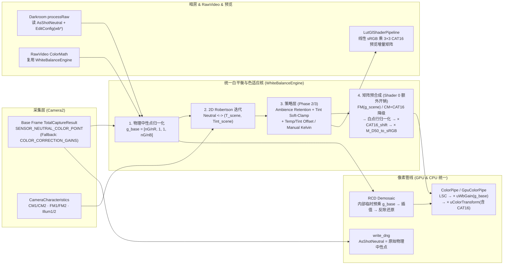

# Darkbag 白平衡与现代色适应架构升级规范 (Phase 1–3 Specification)

**状态**：已定稿待实施 (Approved for Implementation)  
**基线版本**：`refactor/datastore-and-arch-hardening` @ `9ec8d9fd`  
**覆盖阶段**：Phase 1（单一真值源与 2D 数学闭环）· Phase 2（CAT16 氛围优先与黑体轨迹软钳制）· Phase 3（Darkroom 无损 Temp/Tint 与拍摄端 WB 预设/预览联动）  
**参考文献**：
- Adobe DNG Specification 1.4 / 1.6 (Section 6: *Mapping Camera Color Space to CIE XYZ*) & Adobe DNG SDK (`dng_temperature.cpp`, `dng_color_spec.cpp`)
- Wyszecki & Stiles, *Color Science*, 2nd Edition (31-entry Robertson Isotemperature Table)
- Li et al., *"Comprehensive color solutions: CAM16, CAT16, and CAM16-UCS"*, Color Research & Application 2017 / CIE 248:2022
- Darktable Modern Scene-Referred Chromatic Adaptation Pipeline (`colorin` + `channelmixerrgb` / CAT16)

---

## 1. 设计目标、范围边界与五大架构红线

### 1.1 核心目标
彻底根治当前白平衡链路的六大问题——**拍摄直出与暗房白平衡双轨分裂、副摄缺失 `ForwardMatrix` 偏色、流式 HDR+ 锁快门前预览帧 WB、RCD 未白平衡解马赛克伪影、GCam 式低色温“临床死白”与绿植偏品红、以及前后期缺乏 2D 色温/色调控制**——构建一套**单一真值源、GPU 零额外开销、DNG 底片物理纯净、直出兼具专业色彩科学质感**的现代白平衡架构。

### 1.2 范围边界
* **本规范覆盖**：Phase 1、Phase 2、Phase 3。
* **暂不纳入（留待 Phase 4 独立评估）**：RAW 域统计型独立 AWB 引擎（如 CVPR 2019 *Grayness Index*）及单镜头人工白平衡校准存储，待 Phase 1–3 真机基线验证后再决定是否引入。

### 1.3 严格遵守五大架构红线与跨仓库边界 (`AGENTS.md`)
1. **Invariant 1（`CaptureSink` 输出无关 & DNG 物理纯净）**：
   - DNG 导出继续统一走 native `write_dng`；DNG 的 `AsShotNeutral` **必须始终保存未扭曲的场景物理中性点**。氛围保留与创意色温/色调偏移仅属于渲染配方（直出 JPG 与 `EditConfig`），绝不污染底片元数据。
2. **Invariant 2（领域参数正交化）**：
   - 严禁向 JNI 展开散落原语参数；白平衡策略与偏移量归属 `RenderRecipe`（`app/src/main/java/top/maary/darkbag/pipeline/model/RenderRecipe.kt`）/ `EditConfig`（`app/src/main/java/top/maary/darkbag/models/ImageGroup.kt:164-184`），物理白点与增益归属 `CaptureFrameMetadata`（`app/src/main/java/top/maary/darkbag/pipeline/model/CaptureFrameMetadata.kt`），传感器校准矩阵归属 `HardwareProfile`（`app/src/main/java/top/maary/darkbag/pipeline/model/HardwareProfile.kt`）；JNI 新增参数以紧凑结构体或定长 `FloatArray`（`wbParams[4]`）传递。
3. **Invariant 3（模式策略隔离）**：
   - 严禁在 `CameraFragment` 中增加模式分支；拍摄端 WB 预设状态归属 `CameraRuntimeStateHolder`（`app/src/main/java/top/maary/darkbag/camera/state/CameraRuntimeStateHolder.kt`）/ `CameraViewModel`，由 `CameraTaskSpecAssembler`（`app/src/main/java/top/maary/darkbag/camera/dispatch/CameraTaskSpecAssembler.kt`）统一装配。
4. **Invariant 4（零 UI 线程阻塞 & MVI 单向流）**：
   - 所有矩阵合成、取景器增量预览矩阵更新与暗房防抖渲染均在后台/GL 线程完成，UI 层纯被动观测 `StateFlow`。
5. **Invariant 5（Bento Matrix & 纯正单语言 i18n）**：
   - 新增的所有 WB 胶囊、暗房 Tab、设置项和选择弹窗必须遵循 Bento 容器角色与圆角几何规范，**严禁中英双语混排**，全部通过 `@string/...` 在 `values/strings.xml` 与 `values-zh-rCN/strings.xml` 中单语言定义。
6. **跨仓库边界（`hdr-plus` vs Darkbag）**：
   - 新增纯 C++ 色彩数学引擎放置于 `app/src/main/cpp/color/`，**不得侵入 `app/src/main/cpp/hdr-plus/`**，且自身零 Android SDK/NDK 依赖，可直接用主机 `c++` 编译执行数学单元测试。

---

## 2. 现状缺陷定位与目标架构

### 2.1 当前代码库中的 6 处核心缺陷

| # | 缺陷 | 代码定位 | 影响 |
|---|---|---|---|
| **D1** | **直出与暗房 WB 双轨分裂** | `app/src/main/java/top/maary/darkbag/camera/dispatch/CameraCaptureMetadataExtractor.kt:174-280` vs `app/src/main/cpp/native-lib.cpp:340-352` | 拍摄直出乘 `COLOR_CORRECTION_GAINS`（ISP 增益），但插值 CCM、写 DNG 及暗房 `processRaw` 乘的却是 `1 / SENSOR_NEUTRAL_COLOR_POINT`；非 Pixel 机型两者常不等价，导致直出 JPG 与暗房零参数冲洗存在色偏/亮度差。 |
| **D2** | **三份重复实现 + 无 FM 退化漏洞** | `app/src/main/java/top/maary/darkbag/processor/SensorCalibrationHelper.kt:122-255`、`app/src/main/cpp/ColorPipe.cpp:2272-2380`、`app/src/main/cpp/rawvideo/ColorMath.h:23-114` | 缺失 `ForwardMatrix1` 时暗房直接退化为单位阵 `I`（严重偏色），拍摄端退化为粗糙的 `COLOR_CORRECTION_TRANSFORM`；FM 缺少白点行归一化；RawVideo 仍用线性粗估公式。 |
| **D3** | **流式 HDR+ 锁快门前预览帧 WB + 缺除零防护** | `app/src/main/java/top/maary/darkbag/camera/dispatch/HdrPlusBurstCaptureExecutor.kt:73-108`、`app/src/main/java/top/maary/darkbag/camera/dispatch/CameraCaptureMetadataExtractor.kt:175-177` | 未回读自适应选出基准帧（Base Frame）的真实 `TotalCaptureResult`；读取 `Rational` 缺少 `numerator > 0 && denominator > 0` 防护。 |
| **D4** | **RCD 解马赛克未做内部 WB 引导** | `app/src/main/cpp/demosaic/RcdDemosaic.cpp:103`、`app/src/main/cpp/gpu/GpuRcdComputeEngine.cpp:265` | `(void)white_balance;` 忽略 WB，在通道灵敏度相差 1.5×–2.5× 的未白平衡域计算 $R - G / B - G$ 色差，高频灰白边缘易出现彩边。 |
| **D5** | **多摄接力跨传感器裸拷原始增益** | `app/src/main/java/top/maary/darkbag/camera/multicam/FastRelayCaptureStrategy.kt:399-407` | 将主摄 CMOS 的 `COLOR_CORRECTION_GAINS` 直接下发给光谱特性不同的副摄并关掉 AWB，物理上不成立。 |
| **D6** | **100% 临床中和 + 缺乏 2D Temp/Tint 控制** | `app/src/main/java/top/maary/darkbag/pipeline/model/RenderRecipe.kt`、`app/src/main/java/top/maary/darkbag/models/ImageGroup.kt:164-184`、`app/src/main/java/top/maary/darkbag/viewer/editor/DarkroomEditorViewModel.kt` | 暖光氛围被抽干、绿植下 HAL 易偏品红；前后期均无无损色温/色调控制。 |

### 2.2 目标全链路架构



---

## 3. 统一色彩科学与数学模型规范

本节为**唯一数学真值标准**；C++ 主实现与 Kotlin 纯 JVM 镜像在全定义域内误差必须严格 < 1e-5。

### 3.1 CIE 1931 xy ↔ CIE 1960 UCS (u, v) ↔ 2D Robertson (T, Tint)

#### (1) 色度坐标互转
* **xy → uv (CIE 1960 UCS)**：
  $$u = \frac{2x}{1.5 - x + 6y}, \qquad v = \frac{3y}{1.5 - x + 6y}$$
* **uv → xy (CIE 1931)**：
  $$x = \frac{3u}{2u - 8v + 4}, \qquad y = \frac{2v}{2u - 8v + 4}$$
* **xy → XYZ（归一化 Y = 1）**：
  $$\mathbf{XYZ}(x, y) = \left[\frac{x}{y},\ 1.0,\ \frac{1 - x - y}{y}\right]^T \qquad (y \ge 10^{-5})$$

#### (2) 2D Robertson 正向映射：`xyToTempTint(x, y) → (T, tint, duv)`
沿用现有 31 项 `kRobertsonTable[31]`（每行 $(r_i, u_i, v_i, t_i)$，$r_i = 10^6 / T_i$ 为 Mired 倒数色温，$t_i < 0$ 为等温线斜率）。

对节点 $i$ 定义指向品红侧的单位等温线方向向量（$d_u > 0, d_v < 0$）：
$$\hat{d}_{u,i} = \frac{1}{\sqrt{1 + t_i^2}}, \qquad \hat{d}_{v,i} = \frac{t_i}{\sqrt{1 + t_i^2}}$$

遍历 $i = 1 \dots 30$ 计算法向有符号距离 $dt_i = -(u - u_i)\hat{d}_{v,i} + (v - v_i)\hat{d}_{u,i}$：
* 首次满足 $dt_i \le 0$（或到达 $i = 30$）时确定区间权重：
  $$f = \begin{cases} 0, & i = 1 \text{ 或 } dt_i > 0 \\ \frac{-dt_i}{\max(10^{-6},\ dt_{i-1} - dt_i)}, & \text{其他} \end{cases}$$
* 插值 Mired、黑体轨迹点与单位等温线方向（**按单位向量线性插值后重归一化**，避免高 Mired 处 $t_i = -32.6$ 斜率发散）：
  $$r = f \cdot r_{i-1} + (1 - f) \cdot r_i, \qquad T = \frac{10^6}{\max(20.0,\ r)}$$
  $$u_0 = f \cdot u_{i-1} + (1 - f) \cdot u_i, \qquad v_0 = f \cdot v_{i-1} + (1 - f) \cdot v_i$$
  $$(\hat{d}_u, \hat{d}_v) = \text{normalize}\Big(f \cdot (\hat{d}_{u,i-1}, \hat{d}_{v,i-1}) + (1 - f) \cdot (\hat{d}_{u,i}, \hat{d}_{v,i})\Big)$$
* **Adobe DNG / Lightroom 兼容 Tint 与 ANSI Δuv**：
  $$\text{tint} = 3000.0 \cdot \Big((u - u_0)\hat{d}_u + (v - v_0)\hat{d}_v\Big), \qquad \Delta uv = -\frac{\text{tint}}{3000.0}$$
  > **符号约定（与 Adobe DNG SDK `dng_temperature.cpp` 100% 一致）**：
  > - `tint > 0`（`Δuv < 0`）：光源偏**品红**（黑体轨迹下方）；
  > - `tint < 0`（`Δuv > 0`）：光源偏**绿**（黑体轨迹上方，如荧光灯）。

#### (3) 2D Robertson 逆向映射：`tempTintToXy(T, tint) → (x, y)`
1. 钳制色温 $T_c = \text{clamp}(T,\ 1667.0,\ 50000.0)$，计算 $r = 10^6 / T_c \in [20, 600]$。
2. 在 `kRobertsonTable` 中定位 $r_{i-1} \le r \le r_i$，令 $f = \frac{r_i - r}{r_i - r_{i-1}} \in [0, 1]$。
3. 使用与正向完全一致的单位向量插值求 $(u_0, v_0)$ 与 $(\hat{d}_u, \hat{d}_v)$。
4. 沿等温线偏移并转回 CIE 1931 xy：
   $$u = u_0 + \frac{\text{tint}}{3000.0} \cdot \hat{d}_u, \qquad v = v_0 + \frac{\text{tint}}{3000.0} \cdot \hat{d}_v, \qquad (x, y) = \text{uvToXy}(u, v)$$
* **往返精度门禁**：在 T ∈ [2000K, 15000K]、tint ∈ [-100, +100] 内，往返误差必须满足 |ΔT| < 2K 且 |Δtint| < 0.2。

---

### 3.2 物理白平衡增益归一化契约（消灭双轨分裂）

全工程统一由 `resolveCanonicalNeutralAndWb`（C++ 对应 `resolve_canonical_wb`）生成物理白平衡，优先级严格固定：

1. **首选 `CaptureResult.SENSOR_NEUTRAL_COLOR_POINT`（暗房为 DNG `AsShotNeutral`）**：
   - 合法性校验：三元素有限且 > 1e-4（Kotlin 读 `Rational` 时必须同时校验 `numerator > 0 && denominator > 0`）。
   - 归一化中性点：$n'_i = n_i / n_G$（令 $n'_G = 1.0$）；原始未缩放值可保留或同样按 G 归一化写入 DNG（Adobe DNG 规范中 `AsShotNeutral` 仅依赖比值）。
   - 导出 4 通道线性传感器增益 `[R, Ge, Go, B]`：
     $$g_R = \frac{n_G}{n_R}, \qquad g_{Ge} = 1.0, \qquad g_{Go} = 1.0, \qquad g_B = \frac{n_G}{n_B}$$
2. **次选回退 `CaptureResult.COLOR_CORRECTION_GAINS`**：
   - 仅当 `SENSOR_NEUTRAL_COLOR_POINT` 缺失或非法时触发。
   - 取 $g_{\text{avg}} = 0.5 \cdot (G_e + G_o)$（若 ≤ 1e-4 则取 1.0），四通道同除以 $g_{\text{avg}}$，保证绿通道均值严格为 1.0（杜绝不规范增益引起的曝光跳变），并反推等价 `neutral = [1/g_R, 1.0, 1/g_B]`。
3. **最终安全兜底**：`neutral = [0.50, 1.00, 0.65]`、`wb = [2.0, 1.0, 1.0, 1.538]`。
4. **物理恒等式**：所有路径（单帧、流式 HDR+、普通连拍、暗房 `processRaw`、RawVideo）恒满足 $g_R \cdot n_R = g_G \cdot n_G = g_B \cdot n_B = n_G$。

---

### 3.3 CIE 2016 CAT16 色适应矩阵与白点常数

* **标准白点（Y = 1.0）**：
  - $\mathbf{W}_{D50} = [0.96422,\ 1.00000,\ 0.82521]^T$（与现有 `M_XYZ_D50_TO_SRGB` 精确对齐至 1e-7）
  - $\mathbf{W}_{D65} = [0.9504559,\ 1.0000000,\ 1.0890578]^T$
* **CAT16 正/逆变换矩阵（行主序，精度 1e-7，数值验证误差 < 1e-7）**：
  $$\mathbf{M}_{\text{CAT16}} = \begin{bmatrix} +0.4012880 & +0.6501730 & -0.0514610 \\ -0.2502680 & +1.2044140 & +0.0458540 \\ -0.0020790 & +0.0489520 & +0.9531270 \end{bmatrix}$$
  $$\mathbf{M}_{\text{CAT16}}^{-1} = \begin{bmatrix} +1.8620679 & -1.0112546 & +0.1491868 \\ +0.3875265 & +0.6214474 & -0.0089740 \\ -0.0158415 & -0.0341229 & +1.0499644 \end{bmatrix}$$
* **源白点 $\mathbf{W}_{\text{src}}$ 到目标白点 $\mathbf{W}_{\text{dst}}$ 的 CAT16 适应矩阵**：
  $$\mathbf{LMS}_{\text{src}} = \mathbf{M}_{\text{CAT16}} \mathbf{W}_{\text{src}}, \qquad \mathbf{LMS}_{\text{dst}} = \mathbf{M}_{\text{CAT16}} \mathbf{W}_{\text{dst}}$$
  $$\mathbf{M}_{\text{CAT16\_adapt}}(\mathbf{W}_{\text{src}} \to \mathbf{W}_{\text{dst}}) = \mathbf{M}_{\text{CAT16}}^{-1} \cdot \text{diag}\left(\frac{L_{\text{dst}}}{L_{\text{src}}},\ \frac{M_{\text{dst}}}{M_{\text{src}}},\ \frac{S_{\text{dst}}}{S_{\text{src}}}\right) \cdot \mathbf{M}_{\text{CAT16}}$$
  （分母保护 $|LMS_{\text{src},k}| \ge 10^{-5}$。）

---

### 3.4 传感器到 D50 PCS 矩阵合成（双路径 + 白点行归一化）

1. **2D 不动点迭代求解场景光源**：
   - 使用 10 轮阻尼不动点迭代（阻尼因子 α = 0.5），在 `ColorMatrix1/2` 间按 Mired 权重 $g \in [0, 1]$ 插值 $\mathbf{CM}(g)$，由 $\mathbf{CM}(g)^{-1} \cdot \mathbf{n}_{\text{scene}}$ 求 $(x_s, y_s)$，调用 `xyToTempTint(x_s, y_s)` 收敛得到 $(T_s, \text{Tint}_s)$、$\mathbf{W}_{\text{scene}} = \mathbf{XYZ}(x_s, y_s)$ 及 $g_s$。
   - **物理约束**：传感器矩阵插值权重 $g_s$ 始终由**实际照射到传感器的物理光源 $T_s$** 决定，不受后期创意色温调整影响。
2. **路径 A：`ForwardMatrix1` 有效（$\|\mathbf{FM}_1\|_1 > 10^{-3}$ 且 $|\det(\mathbf{FM}_1)| > 10^{-5}$）**：
   - 插值 $\mathbf{FM}(g_s) = g_s \cdot \mathbf{FM}_1 + (1 - g_s) \cdot \mathbf{FM}_2$（若 $\mathbf{FM}_2$ 为空则复用 $\mathbf{FM}_1$）。
   - **白点行归一化（Neutral Preservation Guard）**：计算 $\mathbf{w}_{\text{fm}} = \mathbf{FM}(g_s) \cdot [1, 1, 1]^T$；若三项均 > 0.1，则按行缩放：
     $$\mathbf{FM}_{\text{D50}}[r, c] = \mathbf{FM}(g_s)[r, c] \cdot \frac{W_{D50, r}}{w_{\text{fm}, r}} \qquad (r \in \{0, 1, 2\})$$
     消除厂商有理数舍入偏差，严格保证 $\mathbf{FM}_{\text{D50}} \cdot [1, 1, 1]^T = \mathbf{W}_{D50}$。若 $\mathbf{w}_{\text{fm}}$ 异常则降级至路径 B。
3. **路径 B：`ForwardMatrix1` 缺失或病态时的 Adobe DNG 标准降级推导**：
   - 若 $\mathbf{CM}(g_s)$ 可逆（$|\det(\mathbf{CM}(g_s))| > 10^{-6}$），令 $\mathbf{D}_{\text{wb}}^{-1} = \text{diag}(1/g_R, 1, 1/g_B)$、$\mathbf{W}_{\text{raw}} = \mathbf{CM}(g_s)^{-1} \cdot \mathbf{D}_{\text{wb}}^{-1} \cdot [1, 1, 1]^T$、$s = 1 / \max(10^{-5}, W_{\text{raw}, Y})$、$\mathbf{W}_{\text{scene}} = s \cdot \mathbf{W}_{\text{raw}}$：
     $$\mathbf{FM}_{\text{D50}} = s \cdot \mathbf{M}_{\text{CAT16\_adapt}}(\mathbf{W}_{\text{scene}} \to \mathbf{W}_{D50}) \cdot \mathbf{CM}(g_s)^{-1} \cdot \mathbf{D}_{\text{wb}}^{-1}$$
     数学上严格满足 $\mathbf{FM}_{\text{D50}} \cdot [1, 1, 1]^T = \mathbf{W}_{D50}$。
   - 若连 `ColorMatrix1` 也缺失，返回 `valid = false`，交由调用方回退至 HAL `COLOR_CORRECTION_TRANSFORM`（拍摄端）或单位阵（暗房端）。

---

### 3.5 Phase 2：基于 CAT16 的“氛围优先”与“黑体轨迹软钳制”策略

所有策略均在 $(M, \text{Tint})$ 均匀感知空间求目标适应白点，并通过单一 3×3 CAT16 增量矩阵合并进 `renderCcm`，**逐像素渲染增加 0 ms 耗时**。

#### (1) 白平衡模式定义 (`WhiteBalanceMode`)
| 枚举值 | 名称 | 基准目标适应白点 $(M_{\text{base}}, \text{Tint}_{\text{base}})$ |
|---|---|---|
| `0` | `NEUTRAL`（准确中性） | $M_{\text{base}} = M_s$，$\text{Tint}_{\text{base}} = \text{Tint}_s$（100% 中和，兼容旧图） |
| `1` | `AMBIENCE`（氛围优先，新拍默认） | 低色温不完全色适应 + 普朗克黑体轨迹 Tint 软钳制 |
| `2` | `PRESET_OR_MANUAL`（手动/预设） | 直接锚定用户指定的 $T_{\text{manual}} \in [2000\text{K}, 10000\text{K}]$ 与 $\text{Tint}_{\text{manual}}$ |

#### (2) `AMBIENCE` 模式解析曲线（$C^1$ 连续）
令 $M_s = 10^6 / \text{clamp}(T_s, 1667, 50000)$：

1. **低色温暖调保留（Incomplete Chromatic Adaptation）**：
   - 日光及冷光（$T_s \ge 5000\text{K}$，即 $M_s \le 200$）：保留量为 0，维持纯净中性白。
   - 暖光区（$T_s < 5000\text{K}$，$M_s > 200$）：
     $$w = \text{smoothstep}(200.0,\ 230.0,\ M_s), \qquad d = \max(0.0,\ M_s - 200.0)$$
     $$\Delta M_{\text{retain}} = 48.0 \cdot \tanh\left(\frac{0.22 \cdot d \cdot w}{48.0}\right), \qquad M_{\text{base}} = M_s - \Delta M_{\text{retain}}$$
   - **典型工作点**：
     | 场景实际色温 $T_s$ | $M_s$ | 保留暖意 $\Delta M_{\text{retain}}$ | 实际适应白点 $T_{\text{base}}$ | 视觉预期 |
     |---|---|---|---|---|
     | 6500K / 5500K | 154 / 182 | 0.0 Mired | 6500K / 5500K | 纯净中性 |
     | 4300K 午后暖阳 | 232.6 | 7.1 Mired | 4435K | 极轻微暖意 |
     | 3500K 黄昏/咖啡馆 | 285.7 | 17.9 Mired | 3734K | 自然通透暖调 |
     | 3000K 室内钨丝灯 | 333.3 | 26.2 Mired | 3256K | 温暖氛围、肤色不脏 |
     | 2500K 烛光/路灯 | 400.0 | 34.8 Mired | 2738K | 浓郁氛围且不爆红 |
     | 2000K 极暖光 | 500.0 | 42.3 Mired | 2185K | 渐近封顶（≤ 48 Mired） |

2. **普朗克黑体轨迹 Tint 软钳制（抗绿植偏品红 / 异常偏绿）**：
   - 死区膝点 $\tau_0 = 18.0$（$|\Delta uv| = 0.006$，正常日光/轻度荧光灯完全放行），渐近余量 $\tau_{\text{span}} = 18.0$（硬上限 ±36.0，即 $|\Delta uv| \le 0.012$）：
     $$\text{Tint}_{\text{base}} = \begin{cases} \text{Tint}_s, & |\text{Tint}_s| \le 18.0 \\ \text{sign}(\text{Tint}_s) \cdot \left(18.0 + 18.0 \cdot \tanh\left(\frac{|\text{Tint}_s| - 18.0}{18.0}\right)\right), & |\text{Tint}_s| > 18.0 \end{cases}$$

#### (3) 叠加创意偏移与亮度守恒矩阵合成
* **用户滑块符号定义（与 Lightroom / Capture One 直觉一致）**：
  - `wbTempOffset` ∈ [-150, +150] Mired：**正值变暖，负值变冷**；
  - `wbTintOffset` ∈ [-100, +100] Adobe Tint：**正值偏品红，负值偏绿**。
* **目标适应白点**：
  $$M_{\text{target}} = \text{clamp}(M_{\text{base}} - \text{wbTempOffset},\ 20.0,\ 600.0), \qquad T_{\text{target}} = \frac{10^6}{M_{\text{target}}}$$
  $$\text{Tint}_{\text{target}} = \text{clamp}(\text{Tint}_{\text{base}} - \text{wbTintOffset},\ -150.0,\ +150.0)$$
* **CAT16 增量色适应 + 亮度守恒归一化**：
  由 $(T_{\text{target}}, \text{Tint}_{\text{target}}) \to \mathbf{W}_{\text{target}}$，计算：
  $$\mathbf{M}_{\text{shift}} = \mathbf{M}_{\text{CAT16\_adapt}}(\mathbf{W}_{\text{target}} \to \mathbf{W}_{\text{scene}}), \qquad Y_{\text{out}} = (\mathbf{M}_{\text{shift}} \cdot \mathbf{W}_{D50})_Y$$
  $$\mathbf{M}_{\text{shift,norm}} = \frac{1.0}{\max(0.2,\ Y_{\text{out}})} \cdot \mathbf{M}_{\text{shift}}$$
  $$\mathbf{CCM}_{\text{render}} = \mathbf{M}_{\text{XYZ\_D50\_to\_sRGB}} \cdot \mathbf{M}_{\text{shift,norm}} \cdot \mathbf{FM}_{\text{D50}}$$
  *(数值实测：3000K → 3350K 氛围保留时 sRGB 白点映射到 `[1.1466, 0.9717, 0.7964]`，相对亮度 `0.996`，几乎零曝光漂移；当 `target == scene` 时 $\mathbf{M}_{\text{shift,norm}} \equiv \mathbf{I}$。)*

---

### 3.6 RCD 内部临时 WB 引导规范（CPU & GPU）

在不破坏下游 `isWhiteBalanceApplied = false` 无损延迟白平衡契约的前提下，于 `app/src/main/cpp/demosaic/RcdDemosaic.cpp` 与 `app/src/main/cpp/gpu/GpuRcdShader.h` 实现“**预乘 → 插值 → 反除**”：

1. 将传入的 4 通道 `whiteBalance` 归一化为保护权重 $w_R = \text{clamp}(g_R / g_G, 0.25, 8.0)$、$w_G = 1.0$、$w_B = \text{clamp}(g_B / g_G, 0.25, 8.0)$（空指针则全 1.0）。
2. **加载归一化**：黑电平归一化并钳制传感器原始值到 `[0, 1]` 后，乘以对应通道 $w_c$。**严禁在预乘后将上限截断为 1.0**（必须保留 `[0, w_c]` 浮点范围，否则反除后高光发青）。
3. **插值计算**：所有方向判别 `VH_Dir`/`PQ_Dir`、色差与色比均在白平衡均衡域执行。
4. **写出还原**：写出前将 $(R, G, B)$ 分别除以 $(w_R, 1.0, w_B)$ 并钳制到 `[0, 1]`，写回 `uint16_t` 平面缓冲或 `RGBA16F` 纹理。

---

### 3.7 多摄跨镜头 CIE xy 色度锚定规范

修改 `app/src/main/java/top/maary/darkbag/camera/multicam/FastRelayCaptureStrategy.kt:399-407`：
1. 副摄拍摄请求停止复制主摄 `COLOR_CORRECTION_GAINS` / `COLOR_CORRECTION_TRANSFORM`，恢复 `CONTROL_AWB_MODE_AUTO`。
2. 跨镜头白平衡统一在设备无关色度空间完成：将主摄中性点经主摄 `ColorMatrix1/2` 转为 CIE $(x_{\text{main}}, y_{\text{main}})$ 与 $T_{\text{main}}$，再通过副摄自身的 `ColorMatrix1/2` 在 $g(T_{\text{main}})$ 处逆映射为副摄传感器中性点：
   $$\mathbf{n}_{\text{sub}} = \mathbf{CM}_{\text{sub}}(g_{\text{main}}) \cdot \mathbf{XYZ}(x_{\text{main}}, y_{\text{main}})$$
   归一化至 $n_{\text{sub}, G} = 1.0$；仅当导出增益落在合理包络 $g_R, g_B \in [0.5, 5.0]$ 时启用，否则安全回退至副摄自身 `SENSOR_NEUTRAL_COLOR_POINT`。

---

## 4. 分阶段工程落地方案

### Phase 1：单一真值源统一、2D Robertson 数学闭环与底座除错

#### 4.1.1 改动文件清单
| 层级 | 文件路径 | 核心变更 |
|---|---|---|
| **新增纯 C++ 核** | `app/src/main/cpp/color/WhiteBalanceEngine.h`<br>`app/src/main/cpp/color/WhiteBalanceEngine.cpp` | 零 Android 依赖 C++17 模块，封装 2D Robertson、CAT16、双路径 FM/CM 合成、白点行归一化、跨镜头 CIE xy 映射。 |
| **构建** | `app/src/main/cpp/CMakeLists.txt` | 注册 `color/WhiteBalanceEngine.cpp` 及 `include_directories(color)`。 |
| **C++ 渲染与暗房** | `app/src/main/cpp/ColorPipe.h`、`app/src/main/cpp/ColorPipe.cpp`、`app/src/main/cpp/native-lib.cpp` | 删除 `ColorPipe.cpp` 旧版重复 `kRobertsonTable` / `compute_render_ccm`，统一委托 `WhiteBalanceEngine`；`native-lib.cpp` Bayer 快路径使用 `resolve_canonical_wb` 并向 `rcd_demosaic` 传入 `wbVec`（替代 `nullptr`）。 |
| **RawVideo 收敛** | `app/src/main/cpp/rawvideo/ColorMath.h` | 移除线性近似 `2000 + ratio * 3500`，统一调用 `WhiteBalanceEngine`。 |
| **Kotlin 镜像与提取** | `app/src/main/java/top/maary/darkbag/processor/SensorCalibrationHelper.kt`<br>`app/src/main/java/top/maary/darkbag/camera/dispatch/CameraCaptureMetadataExtractor.kt` | 同步 2D Robertson + CAT16 + 无 FM 降级 + 行归一化（保持纯 JVM 可测）；新增 `resolveCanonicalWbAndNeutral(result)` 统一 `wb` 与 `neutralColorPoint` 真值源，补全 `Rational` 除零防护。 |
| **流式 HDR+ 基准帧同步** | `app/src/main/java/top/maary/darkbag/camera/dispatch/HdrPlusBurstProcessingEnqueuer.kt:161-181` | 用 `streamingResult.frames.firstOrNull()?.timestampNs` 查询实际 Base Frame 的 `TotalCaptureResult` 更新 `result`/`wb`/`burstCalib`/`LSC`（缺失时回退 `burstContext.result`）。 |
| **RCD WB 引导** | `app/src/main/cpp/demosaic/RcdDemosaic.cpp`、`app/src/main/cpp/gpu/GpuRcdShader.h`、`app/src/main/cpp/gpu/GpuRcdComputeEngine.cpp` | 实现 3.6 节预乘/反除；GPU Pass A/B 新增 `uniform vec3 uWbScale`，移除加载后对 1.0 的提前截断。 |
| **多摄接力修复** | `app/src/main/java/top/maary/darkbag/camera/multicam/FastRelayCaptureStrategy.kt:399-407` | 停止跨镜头裸拷增益，恢复 `CONTROL_AWB_MODE_AUTO` 并提供 CIE xy 锚定辅助函数。 |

#### 4.1.2 核心 C++ 接口契约 (`WhiteBalanceEngine.h`)
```cpp
namespace darkbag::color {

enum class WhiteBalanceMode : int {
    NEUTRAL = 0,          // 100% 忠实于场景中性点 (AsShotNeutral)
    AMBIENCE = 1,         // 暖光氛围保留 + 普朗克黑体轨迹 Tint 软钳制
    PRESET_OR_MANUAL = 2  // 绝对目标色温/色调 (manualTempK, manualTint)
};

struct WhiteBalanceParams {
    WhiteBalanceMode mode = WhiteBalanceMode::NEUTRAL;
    float tempOffsetMired = 0.0f;  // [-150, +150], 正值变暖
    float tintOffset = 0.0f;       // [-100, +100], 正值偏品红
    float manualTempK = 5500.0f;   // 仅 PRESET_OR_MANUAL 生效
    float manualTint = 0.0f;       // 仅 PRESET_OR_MANUAL 生效
};

struct WhiteBalanceResult {
    float wbGain[4] = {1.0f, 1.0f, 1.0f, 1.0f};   // 归一化传感器增益 [R, Ge, Go, B], G=1
    float neutral[3] = {1.0f, 1.0f, 1.0f};        // 物理中性点 (用于 DNG AsShotNeutral)
    float renderCcm[9] = {1,0,0, 0,1,0, 0,0,1};   // 含 CAT16 的 Sensor->sRGB_D65 矩阵
    float sceneTempK = 5500.0f;
    float sceneTint = 0.0f;
    float targetTempK = 5500.0f;
    float targetTint = 0.0f;
    float illuminantWeight = 1.0f;
    bool usedForwardMatrix = false;
    bool valid = false;
};

} // namespace darkbag::color
```

#### 4.1.3 Phase 1 避坑清单
* **Pitfall 1（RCD 高光反除青边）**：预乘 $w_c$ 后**绝对不可**执行 `LIM01` 截断上限；仅在原始传感器归一化阶段 clamp 到 `[0, 1]`，反除还原后再 clamp 到 `[0, 1]`。
* **Pitfall 2（现有单测兼容）**：`app/src/test/java/top/maary/darkbag/processor/SensorCalibrationTest.kt:227-233` 断言 `computeRenderCcm(null, null)` 返回 `null`——只有当 `forwardMatrix1 == null && colorMatrix1 == null` 时保持返回 `null`，新增 `colorMatrix1 != null` 时的 CAT16 降级用例。
* **Pitfall 3（`GpuRcdShader.h` Pass B 中间精度）**：`greenIntermTex_` 为 `GL_R32F`，`sBayer`/`sGreen` 均为 `float`，无 16-bit 溢出风险；但需确保 Pass B 最终 `imageStore` 前除以 `uWbScale` 再 `clamp(0.0, 1.0)`。

---

### Phase 2：CAT16“氛围优先”与“黑体轨迹软钳制”落地

#### 4.2.1 改动文件清单
| 层级 | 文件路径 | 核心变更 |
|---|---|---|
| **偏好配置** | `app/src/main/java/top/maary/darkbag/repository/PreferenceKeys.kt`、`app/src/main/java/top/maary/darkbag/repository/SettingsRepository.kt`、`DarkbagPreferences` | 新增 `KEY_WB_STRATEGY = "wb_strategy"`（`Int`，默认 `1 = AMBIENCE`，可选 `0 = NEUTRAL`）。 |
| **领域模型** | `app/src/main/java/top/maary/darkbag/pipeline/model/RenderRecipe.kt`、`app/src/main/java/top/maary/darkbag/models/ImageGroup.kt:164-196`、`app/src/main/java/top/maary/darkbag/camera/dispatch/CameraTaskSpecAssembler.kt` | `RenderRecipe`、`EditConfig`、`BasicAdjustments` 新增正交字段：`wbMode: Int = 0`、`wbTempOffset: Float = 0f`、`wbTintOffset: Float = 0f`、`wbManualTempK: Float = 5500f`。 |
| **EXIF 配方读写** | `app/src/main/java/top/maary/darkbag/utils/ExifMetadataApplier.kt:91-129`、`app/src/main/java/top/maary/darkbag/repository/ImageRepository.kt:463-505` | JSON 读写新增 `wb_mode`、`wb_temp_offset`、`wb_tint_offset`、`wb_manual_temp_k`（`optInt(..., 0)` 保证老照片 100% 向后兼容，不突变）。 |
| **JNI & 暗房透传** | `app/src/main/java/top/maary/darkbag/processor/ColorProcessor.kt`、`app/src/main/cpp/native-lib.cpp`、`app/src/main/java/top/maary/darkbag/pipeline/darkroom/DarkroomRenderEngine.kt` | `processRaw` 增加单个可选参数 `wbParams: FloatArray? = null`（4-float：`[mode, tempOffset, tintOffset, manualTempK]`），严格遵守 Invariant 2。 |
| **设置页 UI** | `app/src/main/java/top/maary/darkbag/fragments/SettingsFragment.kt`、`SettingsBentoDelegate.kt`、`strings.xml` / `values-zh-rCN/strings.xml` | 在色彩引擎 Bento 卡片新增单语言设置项“白平衡风格”（`氛围优先` / `准确中性`；英文 `Ambience Priority` / `Neutral`），接入 `BentoSelectionBottomSheet.show`。 |

#### 4.2.2 关键一致性保证
* **历史照片零漂移**：旧图无 `wb_mode` 字段时默认解出 `0 (NEUTRAL)`，零改动复现原观感。
* **拍后进暗房零跳色**：新拍照片把当前 `wbMode` 随 `EditConfig` 写入 EXIF；进暗房调曝光或切 LUT 时保持同一 `wbMode = AMBIENCE` 起点。
* **DNG 零污染**：`write_dng` 只将原始物理 `neutralColorPoint` 写入 `AsShotNeutral`，确保导入 Lightroom/ACR 读数准确。

---

### Phase 3：Darkroom 无损 Temp/Tint 编辑与拍摄端 WB 预设/预览联动

#### 4.3.1 Darkroom 暗房无损白平衡编辑
1. **Bento 调节面板 (`app/src/main/res/layout/fragment_image_viewer.xml:639-755`)**：
   - 调节面板 Tab 栏由 4 个扩展为 5 个等宽紧凑 Tab：`LIGHT` · `RANGE` · `TONE` · **`WB`** · `COLOR`（全部改用 `@string/edit_tab_*` 单语言资源）。
   - 选中 **`WB`** Tab（索引 `3`，`COLOR` 顺延为 `4`）时绑定双滑块：
     - **Slider 1**：`Temp`（范围 `-100f..+100f` Mired，正值变暖、负值变冷，格式 `"+25"` / `"-15"`）；
     - **Slider 2**：`Tint`（范围 `-80f..+80f`，正值偏品红、负值偏绿，格式 `"+12"` / `"-8"`）。
   - 滑块卡顶部（仅 `WB` Tab 可见）提供紧凑 Bento 策略切换芯片（`氛围` / `中性`），并天然兼容半格 `adjustments[0/1]` 分帧独立调色。
2. **MVI 编排 (`DarkroomEditorUiState.kt` / `DarkroomEditorViewModel.kt` / `DarkroomEditorController.kt`)**：
   - `DarkroomEditorUserIntent` 新增 `SetWbMode(val mode: Int)`；`EditConfig.toBasic()` 与 `applySliderChange` 完整透传 `wbMode/wbTempOffset/wbTintOffset`。
   - **可选跟进加速（建议评估）**：当前暗房拖动滑块防抖 150ms 会重跑一次 `unpack + RCD`（~300ms）；依托 Phase 1 延迟白平衡，可在编辑会话内缓存 1280px 降采样线性传感器 RGB，滑块拖动仅重跑 `ColorPipe`（< 10ms），导出全图仍走全分辨率无损管线。

#### 4.3.2 拍摄端专业 WB 预设与取景器 WYSIWYG 联动
1. **运行时状态 (`app/src/main/java/top/maary/darkbag/camera/state/CameraRuntimeStateHolder.kt`)**：
   - 新增 `isManualWb: Boolean`、`manualWbTempK: Int = 5500`、`liveWbTempK: Int = 5500`、`liveWbTint: Float = 0f`；`hasAnyManualOverride` 纳入 `isManualWb`。
   - `app/src/main/java/top/maary/darkbag/camera/session/CameraHardwareStreamController.kt:183-244`（`handleCaptureResult`）在既有 250ms 遥测节流窗口内同步更新 `liveWbTempK/liveWbTint` 与 `pill_wb` 显示文本（严格零主线程计算）。
2. **Pro 信息条与滚轮 (`app/src/main/res/layout/camera_ui_container.xml:201-308` & `app/src/main/java/top/maary/darkbag/camera/delegate/ProDialItemFactory.kt`)**：
   - 在 `pro_info_bar_card` 新增 `pill_wb`（双行遥测：`WB` / `AUTO` 或 `5500K`，受 `maxLines="2"` 保护）；
   - `ProDialItemFactory.buildWbDialItems()` 提供刻度：`AUTO` + 标准锚点（`2800K`、`3200K`、`4000K`、`5500K`、`6500K`、`7500K`）及 200K 细刻度（2400K–9000K）。
3. **跨机型 100% 稳健的取景器 GL 增量预览 (`app/src/main/java/top/maary/darkbag/processor/LutGlShaderPipeline.kt:373-392`)**：
   - **架构决策**：Camera2 预览流**不强行下发 `CONTROL_AWB_MODE_OFF`**（规避各家 HAL 冻结/发绿兼容雷区），保持 `CONTROL_AWB_MODE_AUTO` 稳定运行；
   - 根据实时估算的 `(liveWbTempK, liveWbTint)` 与目标策略/手动 K 值，在后台线程计算 sRGB 域 CAT16 增量矩阵：
     $$\mathbf{M}_{\text{preview\_wb}} = \mathbf{M}_{\text{XYZ\_to\_sRGB\_D65}} \cdot \mathbf{M}_{\text{CAT16\_adapt}}(\mathbf{W}_{\text{target}} \to \mathbf{W}_{\text{live}})_{\text{luma-norm}} \cdot \mathbf{M}_{\text{sRGB\_D65\_to\_XYZ}}$$
   - 在 `LutGlShaderPipeline.kt` 片段着色器中新增 `uniform mat3 uWbPreviewMatrix`（默认单位阵 `I`），在 `srgbToLinear(src.rgb)` 之后、Log/LUT/Tone Mapping 之前统一应用 `max(vec3(0.0), uWbPreviewMatrix * linearRgb)`，实现跨机型一致、丝滑的所见即所得预览。

---

## 5. 量化验收矩阵、质量门禁与多 Agent 交付节奏

### 5.1 自动化单元测试门禁 (`./gradlew testDebugUnitTest --rerun-tasks` 100% Pass)

| Phase | 测试套件 | 必测量化断言 |
|---|---|---|
| **Phase 1** | `app/src/test/java/top/maary/darkbag/processor/SensorCalibrationTest.kt`<br>新增 `WhiteBalanceEngineTest.kt`<br>`CameraDispatchHelpersTest.kt`<br>`MultiCamHelpersTest.kt`<br>Host C++ 数学测试 | 1. **2D Robertson 往返**：T ∈ {2200, 2856, 3500, 4500, 5500, 6504, 9000} × Tint ∈ {-60, -20, 0, +20, +60}，误差 \|ΔT\| < 2K、\|ΔTint\| < 0.2；<br>2. **中性灰守恒**：有 FM 路径与无 FM（CM + CAT16）路径，`[1, 1, 1]` → sRGB `[1, 1, 1]` 误差 < 1e-4；<br>3. **行归一化自愈**：将 FM1 行和人为扰动 3%，归一化后 `[1, 1, 1]` 仍精确映至 `[1, 1, 1]`；<br>4. **真值源对齐 & 防除零**：`SENSOR_NEUTRAL_COLOR_POINT` 与 `COLOR_CORRECTION_GAINS` 不一致时单帧/流式/暗房得出完全一致的 G=1 归一化增益；`Rational(0, 0)` 安全降级；<br>5. **跨镜头 CIE xy 映射**：双传感器对同一 D65/StdA 光源映射误差 < 1e-3；<br>6. **C++ / Kotlin 一致性**：主机编译 `WhiteBalanceEngine.cpp` 实跑结果与 Kotlin 镜像偏差 < 1e-5。 |
| **Phase 2** | `WhiteBalancePolicyTest.kt`<br>`ExifMetadataApplierTest.kt`<br>`SettingsRepositoryTest.kt` | 1. **氛围曲线**：T ≥ 5000K 保留量 = 0；3000K 为 26 ± 2 Mired；2000K ≤ 48 Mired；<br>2. **Tint 软钳制**：\|Tint\| ≤ 18 零变化；Tint = -50 收敛至 -35 ± 1；极值严格在 [-36, +36]；<br>3. **亮度守恒**：施加氛围保留及 ±100 Mired 偏移后，D50 中性点 $Y_{\text{out}} \in [0.99, 1.01]$；<br>4. **旧 EXIF 向后兼容**：缺失 `wb_*` 键时反序列化严格得 `wbMode = 0, offsets = 0f`。 |
| **Phase 3** | `DarkroomEditorViewModelTest.kt`<br>`DarkroomRenderSpecTest.kt`<br>`LutGlShaderPipelineTest.kt`<br>`ProDialItemFactoryTest.kt` | 1. 暗房 WB Tab 双滑块状态、半格两帧独立隔离、取消/重置恢复；<br>2. `ProDialItemFactory.buildWbDialItems()` 锚点与范围完整性；<br>3. `LutGlShaderPipeline` 预览增量矩阵：无偏移为单位阵，暖偏移满足 R > G > B 且亮度守恒。 |

### 5.2 原生编译与实机画质验收清单
1. **原生编译门禁**：`./gradlew :app:buildCMakeRelease[arm64-v8a]`（0 Errors, 0 Warnings）。
2. **真机 A/B 实拍验收（Phase 1–2 后即可执行）**：
   - **直出 vs. 暗房一致性**：同帧 RAW+JPG 与暗房零滑块导出 JPG 的平均 RGB 偏差 < 1/255；
   - **低色温暖光（2800K–3500K 室内/黄昏）**：对比 `NEUTRAL` vs `AMBIENCE`，确认氛围自然且肤色清透不偏紫；
   - **大面积绿植/草地**：确认开启 `AMBIENCE` 黑体软钳制后无明显品红偏移；
   - **高频灰白网格/文字边缘**：200% 放大验证 RCD 临时 WB 引导对彩边的抑制；
   - **第三方 RAW 兼容**：将导出 DNG 导入 Lightroom / RawTherapee，验证 `AsShotNeutral` 与色温/色调读数无偏色。

### 5.3 分阶段原子提交与双环审查计划 (`AGENTS.md` §4–5)
每个阶段独立完成编码、自测、独立 `design_and_code_reviewer` 子 Agent 审计并获得显式 **`APPROVED`** 签发后，执行原子 Commit 并推送远端：
1. **Commit 1（Phase 1）**：`feat(color): unify 2D Robertson + CAT16 WB engine, RCD WB guidance, and base-frame sync`
2. **Commit 2（Phase 2）**：`feat(color): add CAT16 ambience-priority WB and Planckian tint dampening`
3. **Commit 3（Phase 3）**：`feat(darkroom,camera): add lossless Temp/Tint editor controls and live WB preview presets`
