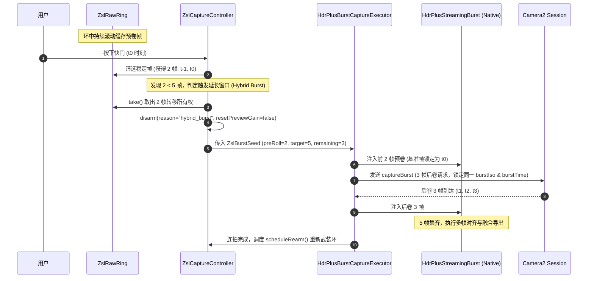

# ZSL 运动自适应降帧、架构内聚度审查与设置联动分析报告

> **范围说明**：本报告基于 Darkbag 当前工作区代码审计与架构设计演进编写，作为 ZSL 机制优化、架构解耦、设置聚合与场景运动监测的**唯一权威基准文档（Single Source of Truth）**。所有改动均须严格对照本报告中的硬性要求进行验收。

---

## 目录

1. [议题一：场景快速变化 / 运动监测与 ZSL HDR+ 自适应降帧及单帧回退可行性](#1-议题一场景快速变化--运动监测与-zsl-hdr-自适应降帧及单帧回退可行性)
2. [议题二：当前 ZSL 改动的高内聚 / 低耦合与防超级类规范审计](#2-议题二当前-zsl-改动的高内聚--低耦合与防超级类规范审计)
3. [议题三：Experimental 设置中的 ZSL 聚合与 ZSL ↔ HDR+ 联动矩阵](#3-议题三experimental-设置中的-zsl-聚合与-zsl--hdr-联动矩阵)
4. [议题四：组合 D 混合延长窗口（Hybrid ZSL）机制与 HDR+/ZSL/Motion Photo 三位一体时序](#4-议题四组合-d-混合延长窗口hybrid-zsl机制与-hdrzslmotion-photo-三位一体时序)
5. [架构瘦身与解耦的明确硬性要求（Hard Metrics & Invariants）](#5-架构瘦身与解耦的明确硬性要求hard-metrics--invariants)
6. [综合演进路线图与阶段实施顺序](#6-综合演进路线图与阶段实施顺序)

---

## 1. 议题一：场景快速变化 / 运动监测与 ZSL HDR+ 自适应降帧及单帧回退可行性

### 1.1 现状根因：为什么现有 ZSL 对“快速运动场景”盲视？

当前 ZSL 多帧选帧门禁位于 [ZslFrameSelector.kt](file:///home/maary/.gemini/antigravity/worktrees/Darkbag/review_zsl_implementation/app/src/main/java/top/maary/darkbag/camera/zsl/ZslFrameSelector.kt#L72-L96)，`stableRunIndices()` 与 `isStable()` 仅检查以下参数一致性：

- `hasResult == true` 且 `afFocused == true`（[ZslRawRing.kt](file:///home/maary/.gemini/antigravity/worktrees/Darkbag/review_zsl_implementation/app/src/main/java/top/maary/darkbag/camera/zsl/ZslRawRing.kt#L54-L65)）
- `iso` 波动不超过 `EXPOSURE_TOLERANCE`（5%）
- `exposureTimeNs` 波动不超过 `EXPOSURE_TOLERANCE`（5%）
- `cropKey` 一致
- `wb`（`COLOR_CORRECTION_GAINS` 四分量）波动不超过 `WB_TOLERANCE`（5%）

在**光线平稳的白天或室内场景**中，前景主体快速移动（如快速挥手、走动行人）或相机快速平移构图时，曝光、白平衡、对焦状态往往不会跳变。因此 `stableRun()` 依然判定整个预卷窗口“完全稳定”，照常触发满帧数（5~8 帧）的 HDR+ 多帧合成。

同时，[HdrPlusStreamingBurst.kt](file:///home/maary/.gemini/antigravity/worktrees/Darkbag/review_zsl_implementation/app/src/main/java/top/maary/darkbag/processor/HdrPlusStreamingBurst.kt#L103-L119) 在 ZSL 注入种子时设置了 `lockFirstFrameAsReference = true`，绕过了 `ColorProcessor.nativeComputeGcamFrameScore()`（直接赋 `Float.MAX_VALUE`）。虽然 Stage 5 已在 `merge.cpp`、`hdrplus_pipeline_generator.cpp` 与 Sabre 中加入 2×2 Quad 残差门控与双线性光流，显著消除了 32×32 方块撕裂重影，但面对**超出搜索半径的剧烈运动**或**大幅前景突变**时：
1. 强行做 5~8 帧配准与对齐属于无效算力浪费（增加发热与 `HdrPlusRequestManager` 队列排队时间）；
2. 若被选为基帧的第一帧自身带有运动模糊，或其余帧大部分像素被 `quad_gate` 剔除，多帧降噪增益几乎归零，甚至产生局部清晰度/噪点断层；
3. 在高光/常规光照下，直接减少参与合成的帧数或回退至单帧往往能获得更干净、更锐利的定格效果。

---

### 1.2 三类运动监测信号源的可行性对比

| 信号源 | 能否检测“相机静止 + 前景高速运动” | 能否检测“相机自身甩动” | 硬件/管线覆盖现状 | 计算耗时 & 内存开销 | 综合可行性 |
| :--- | :---: | :---: | :--- | :--- | :--- |
| **A. Camera2 `TotalCaptureResult`（OIS/AF/AE/Face）** | 仅人脸场景有限感知 | 需厂商上报 `STATISTICS_OIS_SAMPLES`（碎片化严重） | 当前 [CameraHardwareStreamController.kt](file:///home/maary/.gemini/antigravity/worktrees/Darkbag/review_zsl_implementation/app/src/main/java/top/maary/darkbag/camera/session/CameraHardwareStreamController.kt#L223-L242) 未采集 OIS 样本 | 极低 | **不适合作为主力**（大部分设备 OIS 元数据缺省，且无法感知无曝光变化的局部前景运动） |
| **B. `SensorManager` 陀螺仪（`TYPE_GYROSCOPE`）** | 无法感知 | **极准**（100~200Hz 角速度滑动积分） | 当前仅 [CameraShutterController.kt](file:///home/maary/.gemini/antigravity/worktrees/Darkbag/review_zsl_implementation/app/src/main/java/top/maary/darkbag/camera/delegate/CameraShutterController.kt#L29) 使用 `OrientationEventListener`，尚未接入陀螺仪 | 极低（后台监听几十微瓦，零图像拷贝） | **适合作为辅助快速甩动判定**，但不能单独解决前景快速移动 |
| **C1. 复用现有低分辨率 `analysisImageReader`（YUV_420_888）计算帧间块变化** | **完全支持** | **完全支持** | 已有基础设施！[CameraHardwareStreamController.kt](file:///home/maary/.gemini/antigravity/worktrees/Darkbag/review_zsl_implementation/app/src/main/java/top/maary/darkbag/camera/session/CameraHardwareStreamController.kt#L369-L408) 已创建最小 4:3 YUV 流，目前仅采样算 `lastClippingRatio` | **< 0.1 ms / 帧**（抽样为 16×12 网格仅 192 个数值，零堆分配） | **主力方案（推荐）**：同时兼顾 ZSL 与前向非 ZSL 连拍，且 `LAZY_IMAGE` 下不破坏零拷贝 |
| **C2. `ZslRawRing` 快门瞬间稀疏 Bayer Green 网格比对** | **完全支持** | **完全支持** | 仅 ZSL `RAW_RING` 可用；[ZslRawRing.kt](file:///home/maary/.gemini/antigravity/worktrees/Darkbag/review_zsl_implementation/app/src/main/java/top/maary/darkbag/camera/zsl/ZslRawRing.kt) 已有最近 3~8 帧缓存 | 仅在按下快门时算 1 次，约 **0.2~0.5 ms**（平时 0 开销） | **零平时开销补充方案**：在 `EAGER_COPY` 下甚至不依赖 `analysisImageReader` |

> **关键发现（已有资产可复用）**：
> 1. `CameraHardwareStreamController.kt` Lines 205–207 当前仅在 `(isManualExposure || env.isHdrPlusEnabled) && isMainLens` 时将 `analysisImageReader.surface` 加入 Repeating Request。若将其放宽为“所有支持单摄的镜头 + ZSL 或 HDR+ 启用时”（且仅提取 Y 平面 16×12 块均值），即可在不增加任何新 `ImageReader` 硬件流的前提下获得全镜头场景运动监测能力。
> 2. 现有 `ColorProcessor.nativeComputeGcamFrameScore()`（[HdrPlusJNI.cpp](file:///home/maary/.gemini/antigravity/worktrees/Darkbag/review_zsl_implementation/app/src/main/cpp/HdrPlusJNI.cpp#L1373)）评估的是**单帧锐度/噪声比**，不是帧间位移，但可用于在“回退单帧”时从最近 2 帧中挑出更清晰的一帧（前提是非 `LAZY_IMAGE` 全拷贝，或结合近邻帧选择）。

---

### 1.3 可落地的算法设计：归一化分块网格运动评估（Block-Grid Motion Metric）

之所以不能简单做“整帧全局平均亮度差”（手在局部快速挥动时整帧均值可能只变 1%~2%），而应做**空间分块（例如 16×12 = 192 个区块）+ 局部异常占比统计**：

1. **网格特征提取（每帧仅 ~192 字节/浮点，复用固定数组零 GC）**：
   - 将分析图（YUV 的 Y 平面，或 Bayer 帧间隔采样 Green 像素）划分为 `16 × 12` 网格；每个格子稀疏采样 `4 × 4` 个点求均值，得到特征向量 $M_t[0..191]$ 与整帧均值 $\mu_t$。
2. **亮度对齐残差（消除 ±5% AE 微波动干扰）**：
   - 对相邻帧（或待选帧 $t_i$ 与基准帧 $t_0$），计算全局亮度比例 $s = \mu_0 / \max(\mu_i, \epsilon)$。
   - 计算每个区块相对残差：
     $$d_k = \frac{|M_0[k] - s \cdot M_i[k]|}{\max(M_0[k], \sigma_{\text{floor}})}$$
     其中 $\sigma_{\text{floor}}$ 为低光防抖下限（YUV 8-bit 约 `8.0 ~ 12.0`），避免暗部噪声误触发运动警报。
3. **双指标判定（同时捕获局部前景高速运动与全局剧烈晃动）**：
   - **全局平均变化 `globalDelta`** = $\text{mean}(d_k)$：捕捉整体平移/摇镜/切场景；
   - **高变区块占比 `movingAreaRatio`** = $\text{count}(d_k > \tau_{\text{block}}) / 192$：捕捉**机位固定、手在画面 10%~40% 区域快速挥动**的典型痛点！
   - 对当前帧率/时间间隔 $\Delta t = t_0 - t_i$ 归一化后，可得到平滑后的**场景运动等级** `MotionLevel`：`STILL` / `MODERATE` / `FAST`。

---

### 1.4 在 ZSL HDR+ 下的分级回退策略与画质权衡（关键边界）

直接把快速运动全都无条件砍成单张是有风险的，必须结合**当前亮度（ISO/快门）**与 **ZSL 预览 EV 策略**一起联动：

1. **四档阶梯决策矩阵（仅在自适应策略允许时执行）**：
   - **`MotionLevel.STILL`（静止/慢速）**：维持满配目标帧数 `min(requestedBurst, ring.depth)`（例如 5~8 帧），获取最强动态范围与降噪。
   - **`MotionLevel.MODERATE`（中速局部变化 / 手持微晃）**：**收敛连拍时间窗至最短 3 帧（`MIN_HDR_FRAMES = 3`）**。
     - *原因*：在 30fps 下，5~8 帧跨越 `166~266 ms`，而只取紧邻 `t0` 的最新 3 帧仅跨越 **`~66 ms`**，帧间位移直接缩减 60% 以上！同时仍满足 HDR+ 管线最低 3 帧门槛（[ZslModels.kt](file:///home/maary/.gemini/antigravity/worktrees/Darkbag/review_zsl_implementation/app/src/main/java/top/maary/darkbag/camera/zsl/ZslModels.kt#L90)），保持多帧融合高光保护与低噪点。
   - **`MotionLevel.FAST` + 非中暗光（例如 ISO < 50% `isoUpper` 且快门未接近上限）**：**降级为单帧抓拍（`motion_single_fallback`）**，走 `captureFrameFromRing`（`SINGLE_RAW` 管线 + 携带当前 `hdrDigitalGain` 补偿）。
     - *原因*：高信噪比亮光环境下，单帧提取 1 stop 欠曝的亮度损耗轻微，完全避免多帧重影或拖慢排队，快门瞬间定格动作。
   - **`MotionLevel.FAST` + 中暗光（高 ISO 且 ZSL 当前运行在 `-1 EV` 欠曝预卷）**：**锁定降帧至 3 帧 HDR+（而非退单帧）**，或提示回退前向连拍（若需要正曝光单帧）。
     - *核心物理权衡（不可忽略）*：ZSL HDR+ 默认处于 `-1 EV` 预卷并依靠 `hdrDigitalGain = 2.0f` 拉亮，若在中暗光下退回单帧，`+1 EV` 增益会把单帧暗部噪声放大 1 档；而 3 帧（仅 66ms）配合 Stage 5 的 `2×2 quad_gate` 仍可抑制单帧热噪并把运动块自动丢弃退回参考帧。

2. **对非 ZSL（关闭 ZSL）前向 HDR+ 的同步收益**：
   - 如果运动监测放在通用流（方案 C1：`SceneMotionMonitor` 挂载在 `analysisImageReader` 上），则**关闭 ZSL 时前向 HDR+** 在快门按下瞬间也可读取当前场景的 `MotionLevel`，在 `FAST` 场景下自动把前向连拍目标帧数由 5/8 缩减为 3 帧（或在单帧允许模式下给出可选回退），直接呼应“关闭或打开 ZSL 均有快速运动重影风险”的实际体验。

---

## 2. 议题二：当前 ZSL 改动的高内聚 / 低耦合与防超级类规范审计

依据仓库 [AGENTS.md](file:///home/maary/.gemini/antigravity/worktrees/Darkbag/review_zsl_implementation/AGENTS.md)（五大架构红线 Invariants 1–5 与 `<code_quality>`），对当前所有 ZSL 相关文件进行静态度量与依赖关系审计。

### 2.1 代码规模与职责分布观测

| 文件 | 行数 | 架构评价 | 核心观察 |
| :--- | :---: | :--- | :--- |
| [ZslModels.kt](file:///home/maary/.gemini/antigravity/worktrees/Darkbag/review_zsl_implementation/app/src/main/java/top/maary/darkbag/camera/zsl/ZslModels.kt) | 242 | **优秀** | 纯 Kotlin 领域模型与策略（`ZslCapabilityEvaluator`, `ZslAdaptivePolicy`, `ZslRingConfig`），零 Android 依赖，完全可 JVM 单测 |
| [ZslFrameSelector.kt](file:///home/maary/.gemini/antigravity/worktrees/Darkbag/review_zsl_implementation/app/src/main/java/top/maary/darkbag/camera/zsl/ZslFrameSelector.kt) | 97 | **优秀** | 纯算法选帧（`latestValidIndex`, `nearestIndex`, `stableRunIndices`, `isStable`），无缓冲/Camera2 状态污染 |
| [RawFrameRouter.kt](file:///home/maary/.gemini/antigravity/worktrees/Darkbag/review_zsl_implementation/app/src/main/java/top/maary/darkbag/camera/zsl/RawFrameRouter.kt) | 280 | **良好** | 单点独占 `ImageReader.OnImageAvailableListener`，通过 `IDLE`/`RING`/`CAPTURE` 状态机防止偷帧 |
| [ZslDebugState.kt](file:///home/maary/.gemini/antigravity/worktrees/Darkbag/review_zsl_implementation/app/src/main/java/top/maary/darkbag/camera/zsl/ZslDebugState.kt) | 114 | **优秀** | 诊断快照与格式化逻辑分离，纯 Kotlin 可测 |
| [ZslRawRing.kt](file:///home/maary/.gemini/antigravity/worktrees/Darkbag/review_zsl_implementation/app/src/main/java/top/maary/darkbag/camera/zsl/ZslRawRing.kt) | 419 | **中等偏紧** | 兼管环形队列同步、Eager/Lazy 内存拷贝、`TotalCaptureResult` 延迟绑定与 `copyPlane` JNI 调用；整体仍内聚于“Ring 容器”边界，但已接近单类上限 |
| [ZslCaptureController.kt](file:///home/maary/.gemini/antigravity/worktrees/Darkbag/review_zsl_implementation/app/src/main/java/top/maary/darkbag/camera/zsl/ZslCaptureController.kt) | **848** | **⚠️ 超标（God Controller 趋势）** | **显著违反单一职责与防超级类规范**（详见 2.2 节） |
| [CameraHardwareStreamController.kt](file:///home/maary/.gemini/antigravity/worktrees/Darkbag/review_zsl_implementation/app/src/main/java/top/maary/darkbag/camera/session/CameraHardwareStreamController.kt) | **493** | **⚠️ 偏重** | 同时管理 Camera2 设备、CaptureSession、ZSL repeating 参数、YUV 高光直方分析，并在 `handleCaptureResult()` 中直接拼装 Pro 信息栏 UI |
| [SettingsFragment.kt](file:///home/maary/.gemini/antigravity/worktrees/Darkbag/review_zsl_implementation/app/src/main/java/top/maary/darkbag/fragments/SettingsFragment.kt) | **777** | **⚠️ 过重** | 比 `CameraFragment`（395 行）多出近一倍；且内含 ZSL 能力检查业务与与 Delegate 完全重复的状态格式化代码 |
| [SettingsBentoDelegate.kt](file:///home/maary/.gemini/antigravity/worktrees/Darkbag/review_zsl_implementation/app/src/main/java/top/maary/darkbag/fragments/settings/SettingsBentoDelegate.kt) | **525** | **⚠️ 偏重** | 与 `SettingsFragment` 重复实现 `zslStatusValue`，且硬编码了容量数字 |

---

### 2.2 明确的规范符合度与坏味道清单

#### ✅ 符合红线（Invariants 1–4）的部分
1. **Invariant 1（Pipeline-Agnostic Output）**：ZSL 路径严格通过传入 `CaptureSink` 执行输出，未接触 `MediaStore` / `ContentResolver` / `DngCreator`。
2. **Invariant 2（Domain Parameter Orthogonalization）**：单张 ZSL 仅生成 `RawImageHolder` 交给 `CameraCapturePipelineDispatcher.processImageAsync()` 组装 `CaptureTaskSpec`；连拍 ZSL 仅生成轻量 `ZslBurstSeed` 交给 `HdrPlusBurstCaptureExecutor`。
3. **Invariant 3（Shooting Mode Strategy Isolation）**：`CameraFragment` 无新增任何模式分支；模式互斥逻辑位于协调层之下。
4. **Invariant 4（Headless Camera Session & Zero UI Blocking）**：ZSL 全部环维护、路由切换、选帧和发拍操作全部序列化在 `camera2Handler` 与 `ZslRawThread` 上，未阻塞 UI 线程。

#### ❌ 违反高内聚 / 低耦合 / 避免超级类与避免重复规范的问题

1. **`ZslCaptureController`（848 行）承担了 7 种不相干职责，已滑向“ZSL 上帝类”**：
   - **① 生命周期与偏好监听**：`start()`/`stop()` 管理 `env.lifecycleScope` 协程与 `ZslPreferenceSnapshot`；
   - **② 运行时策略准入**：`evaluate()` 里杂糅了模式互斥、`PowerManager` 热节流、`limitByMemory()`、`ZslCapabilityDetector` 调用、`lutProcessor` 空检；
   - **③ Camera2 硬件配置驱动**：直接调用 `stream.setZslPreviewProfile(...)` 与 `stream.setZslRawTargetEnabled(...)`；
   - **④ 跨模块缓冲池内存配额篡改**：直接在 `evaluate`/`disarm`/`attemptRearm`/`trimListener` 中硬编码修改全局静态池 `StreamingBufferPool.setRetentionLimit(0/12)` 与 `HdrPlusBurst.setPoolLimit(0/3)`；
   - **⑤ 探测与重 Arm 状态机**：`runArmProbe()`, `scheduleRearm()`, `attemptRearm()`；
   - **⑥ Capture 执行编排与 UI 副作用越权**：`captureFrameFromRing()`（[ZslCaptureController.kt#L270-L326](file:///home/maary/.gemini/antigravity/worktrees/Darkbag/review_zsl_implementation/app/src/main/java/top/maary/darkbag/camera/zsl/ZslCaptureController.kt#L270-L326)）亲自构建 `RawImageHolder`、亲自维护 `HdrPlusRequestManager.onTaskStarted()` / `onTaskFinished()` 计数、亲自在失败时调用 `HdrPlusBurst.releaseBuffer()`、并直接切 `Dispatchers.Main` 调用 `ui.resetBurstUi()` / `ui.showProcessingAnimation()`；
   - **⑦ Debug 注册表发布**：`publishDebug()`, `noteCapture()`。
   - *风险*：如果直接在该类上继续追加“运动监测状态订阅、分级策略、与设置的深入联动”，文件体积将迅速膨胀超过 1,100 行，测试只能依赖复杂 Mock。

2. **`CameraModeController` ↔ `ZslCaptureController` 存在隐式共享可变属性耦合**：
   - 查看 [CameraModeController.kt#L343-L377](file:///home/maary/.gemini/antigravity/worktrees/Darkbag/review_zsl_implementation/app/src/main/java/top/maary/darkbag/camera/delegate/CameraModeController.kt#L343-L377)：调用 `parts.zsl?.tryCaptureHdrPlus(...)` / `tryCaptureSingle(...)` 返回 `Boolean` 后，紧接着通过外露的 `@Volatile` 字段 `zsl.lastSelectedSensorTimestampNs` 与 `zsl.lastTimestampRealtime` 读取本次选中的时间戳再喂给 `parts.motionPhoto.updatePendingStillTimestamp(...)`。
   - 这属于典型的**时间耦合（Temporal Coupling）与隐式副作用传递**：调用方必须知道“返回 true 之后立刻读这两个字段”，若未来发生并发或异步调度很容易读错批次。理想方式应由抓拍尝试直接返回密封结果对象（或通过回调函数注入选定时间戳）。

3. **`SettingsBentoDelegate` 与 `SettingsFragment` 存在直接的代码重复（违反 `<code_quality>`）**：
   - `zslStatusValue(state)` 在 [SettingsBentoDelegate.kt#L358-L380](file:///home/maary/.gemini/antigravity/worktrees/Darkbag/review_zsl_implementation/app/src/main/java/top/maary/darkbag/fragments/settings/SettingsBentoDelegate.kt#L358-L380) 和 [SettingsFragment.kt#L560-L581](file:///home/maary/.gemini/antigravity/worktrees/Darkbag/review_zsl_implementation/app/src/main/java/top/maary/darkbag/fragments/SettingsFragment.kt#L560-L581) 中**逐行重复了两次**。
   - 且两处都写死了魔数 `minOf(state.hdrBurstCount, 5)` 与 `3`，并在 `SettingsFragment` 中额外维护了一套独立的 `updateZslStatus()`（而 `SettingsBentoDelegate.renderPreferences()` 又会覆盖渲染一次）。

4. **多处重复解析 HDR+ EV 与争抢 Preview Gain 所有权**：
   - **EV 策略分散**：`resolveHdrTargetEv`（[ZslCaptureController.kt#L827-L831](file:///home/maary/.gemini/antigravity/worktrees/Darkbag/review_zsl_implementation/app/src/main/java/top/maary/darkbag/camera/zsl/ZslCaptureController.kt#L827-L831)）、`ExposureUtils.calculateHdrPlusExposure`、`CameraLutController` 各自解析 `"Off"` / `"-1 EV"` / `"-2 EV"` / `"Dynamic"` 字符串。
   - **Preview Gain 双头管理**：`env.sessionArbiter.lutProcessor?.setPreviewGain(...)` 同时被 `ZslCaptureController`（Arm/Disarm）和 `HdrPlusBurstCaptureExecutor`（前向连拍期间）直接读写，缺乏统一的 Gain 仲裁出口；若 ZSL 正在 `disarm("forward_capture")` 与前向 Burst 交替，仅靠消息队列执行顺序保证不被 `1.0f` 误重置。

### 2.3 建议的模块化拆解方案（收敛原则）

建议在后续阶段将 `ZslCaptureController`（848 行）沿边界解耦为 4 个内聚单元（每个 ≤ 220 行）：

1. **`ZslArmingPolicy`（纯 Kotlin，纳入 `ZslModels` 同级）**：合并能力报告、热节流、内存预算、运行模式互斥（Normal / 60fps / Manual / Flash / MultiCam）及运动等级阈值，供控制器和设置 UI **共同消费**，消除设置页与运行时的规则分叉。
2. **`ZslRingSupervisor`**：专职管理 `ZslRawRing` 生命周期、Arm Probe（2 秒帧率检测）、`scheduleRearm` 重试与 `RawFrameRouter` 挂载/卸载，以及对外汇报缓冲池目标保留上限。
3. **`ZslCaptureSelector` / `ZslCaptureFacade`（精简入口）**：只做快门命中判定，输出强类型结果（如 `ZslDispatchOutcome.Consumed(sensorTimestampNs, realtimeTimestamp)` vs `Fallback(reason)`），将 `captureFrameFromRing` 里组装 `RawImageHolder`、管理 `HdrPlusRequestManager` 与调度 `ui` 反馈的代码移回 `SingleRawCaptureExecutor`（实现与 `HdrPlusBurstCaptureExecutor` 对称的“Selector 只产 Seed，Executor 负责管线入队与生命周期记账”）。
4. **`SettingsFragment` 瘦身**：移除重复的 `zslStatusValue()` 与 `updateZslStatus()`，ZSL 状态卡完全由 `SettingsViewModel` 状态流驱动 `SettingsBentoDelegate` 单源渲染。

---

## 3. 议题三：Experimental 设置中的 ZSL 聚合与 ZSL ↔ HDR+ 联动矩阵

### 3.1 当前 `fragment_settings.xml` 中 Exp 区域的视觉与结构问题

查看 [fragment_settings.xml#L1586-L1815](file:///home/maary/.gemini/antigravity/worktrees/Darkbag/review_zsl_implementation/app/src/main/res/layout/fragment_settings.xml#L1586-L1815)，实验性实验室（`section_debug`）当前把所有控件平铺在同一个一级 `BentoTrayCard` 中：

1. `switch_force_60fps`（强制 60fps）
2. `switch_zsl`（零快门延迟主开关）
3. `card_zsl_status`（`ZSL ROUTE` 两行状态卡片）
4. `switch_zsl_lazy_ring`（零拷贝 RAW 环）
5. `switch_zsl_adaptive`（自适应抓拍）
6. **`btn_open_lens_calibration`（自定义镜头畸变标定 — 与 ZSL 无关的按钮强行插在中间！）**
7. 综合诊断卡（上半部分为通用 `tv_debug_stats`，下半部分为 `tv_zsl_debug`）
8. 复制日志 / 清空日志 / 退出实验室按钮

**违反 Bento Matrix 设计结构的问题**：
- 同文件的“高级设置（Advanced Settings）”为每一个功能域（`Compute Pipeline`、`Video Capture`、`Multi-Camera`、`DNG & Storage`、`Viewfinder UI`）都包裹了独立的**嵌套同心 `BentoTrayCard`（`cardCornerRadius="18dp"`，内嵌标题行与 Porcelain 白瓷瓦片）**；
- 而实验性实验室内的 **ZSL 设置与状态没有形成同心子托盘**：主开关、状态卡、子开关散落在外层 `errorContainer` 中，`tv_zsl_debug` 又被 `btn_open_lens_calibration` 和 `tv_debug_stats` 割裂到下方；
- 另外在 `section_debug` 中还残存少量硬编码文案（如 `fragment_settings.xml:1715` 的 `"自定义镜头畸变标定"` 及 `SettingsFragment.kt:453-463` 的日志操作英文 Toast），可在重组时按 Invariant 5 一并完成单语言资源化。

**建议重组结构（Exp 实验室内部子托盘化）**：
- 将 `section_debug` 内部拆成清晰的 3 个同心嵌套模块（与 Advanced 风格完全统一）：
  - **子托盘 1：Zero Shutter Lag（`card_tray_exp_zsl`，`cardCornerRadius="18dp"`，可随“生效/互斥/关闭”动态切换容器语义角色）**
    - 托盘小标题行：`ZERO SHUTTER LAG` + 实时状态胶囊 Badge（例如 `ARMED` / `MUTUAL EXCL.` / `OFF`）
    - Row 1：`switch_zsl`（主开关） + `card_zsl_status`（改为紧凑双行联动微遥测，同时展示路线/帧数与 HDR+ 联动约束）
    - Row 2（`zslEnabled` 展开区）：`switch_zsl_adaptive` + `switch_zsl_lazy_ring`（以及未来若引入运动监测，可在此聚合 `ZSL 运动降帧策略`）
    - Row 3（`zslEnabled` 展开区）：专属的 `tv_zsl_debug` 诊断白瓷卡（独立于通用 `tv_debug_stats`，彻底收拢在 ZSL 托盘底部）
  - **子托盘 2：实验性硬件与标定（`switch_force_60fps` + `btn_open_lens_calibration`）**
  - **子托盘 3：性能诊断日志（`tv_debug_stats` + Copy / Clear Logs）**

---

### 3.2 ZSL 与 HDR+ 及关联设置的全面联动盲区（对照源码逐项梳理）

当前系统把 **HDR+ 计算摄影参数**放在“高级设置 → Group A (`Compute & Merge`)”及取景器 Bento Deck，把 **ZSL 开关与策略**放在“实验性实验室（`section_debug`）”，两者在静态与动态联动上存在 **8 处显著断层**：

| 序号 | 联动关系 | 当前实际代码行为与缺陷 | 建议改进联动逻辑 |
| :---: | :--- | :--- | :--- |
| **1** | **`zslEnabled` ↔ `hdrPlusEnabled`（能力与状态不一致）** | 在设置页打开 `switch_zsl` 时，仅当 `hdrPlusEnabled == true && !supportsHdrPlusZsl` 才 Toast 阻止（[SettingsFragment.kt#L482-L489](file:///home/maary/.gemini/antigravity/worktrees/Darkbag/review_zsl_implementation/app/src/main/java/top/maary/darkbag/fragments/SettingsFragment.kt#L482-L489)）。若用户先关掉 HDR+ 成功打开 ZSL（走 `SINGLE_RAW`），再回到取景器打开 HDR+，ZSL 会在运行时静默 `disarm("hdr_unsupported")`，且设置页若事先把 `hdrPlusEnabled` 打开又关掉，状态提示不会清晰区分“硬件支持单帧 ZSL 但不支持 HDR+ ZSL”。 | 由持久化能力模型明确区分 `singleZslSupported`、`hdrPlusZslSupported`、`maxPreRollFrames`。当用户设备仅支持 Single ZSL 时，允许“单帧模式下启用 ZSL + HDR+ 自动走前向”，并在 ZSL 状态卡中明确提示当前是“仅单帧可用”还是“双模式就绪”。 |
| **2** | **`hdrBurstCount`（3~8 帧）↔ ZSL 环形深度与严格模式死锁** | ① [SettingsBentoDelegate.kt#L370](file:///home/maary/.gemini/antigravity/worktrees/Darkbag/review_zsl_implementation/app/src/main/java/top/maary/darkbag/fragments/settings/SettingsBentoDelegate.kt#L370) 与 [SettingsFragment.kt#L571](file:///home/maary/.gemini/antigravity/worktrees/Darkbag/review_zsl_implementation/app/src/main/java/top/maary/darkbag/fragments/SettingsFragment.kt#L571) 硬编码了 `minOf(state.hdrBurstCount, 5)`，而实际环深度是 `minOf(hdrBurstCount, 8, maxByBudget(frameBytes))`（[ZslModels.kt#L154](file:///home/maary/.gemini/antigravity/worktrees/Darkbag/review_zsl_implementation/app/src/main/java/top/maary/darkbag/camera/zsl/ZslModels.kt#L154)）。<br>② **隐性死锁**：当大底 RAW 使 `maxPreRollFrames = 5`，而用户在 HDR+ 设置里选 `hdrBurstCount = 8` 且关闭 `zslAdaptive = false`（严格模式）时，[ZslCaptureController.kt#L428-L432](file:///home/maary/.gemini/antigravity/worktrees/Darkbag/review_zsl_implementation/app/src/main/java/top/maary/darkbag/camera/zsl/ZslCaptureController.kt#L428-L432) 永远 `pre_roll_short`，**ZSL HDR+ 实际上 100% 不可用**，但界面无任何提醒！ | ① 将动态检测出的真实 `maxPreRollFrames` 写入 `DarkbagPreferences`（或 `ZslCapabilityState`），消除 UI 硬编码 `5`；<br>② 当 `zslEnabled && hdrPlusEnabled && !zslAdaptive && hdrBurstCount > maxPreRollFrames` 时，在 ZSL 托盘内显式提示“连拍帧数超出 ZSL 环上限（需开启自适应或调至 ≤N 帧）”，并在高级设置 `BURST FRAMES` 辅助摘要/Sheet 中标注 ZSL 环上限。 |
| **3** | **`zslAdaptive` ↔ HDR+ OFF（单帧模式）无上下文指示** | `switch_zsl_adaptive` 在 `Profile.HDR_PLUS` 时控制“允许少于 `hdrBurstCount` 的预卷（3..depth）以及快速场景/无稳定序列时回退 `instant_single`”，但在 `hdrPlusEnabled == false` 时该开关完全不参与任何判断，界面却未标明其作用于 HDR+ ZSL。 | 在 ZSL 托盘内将 `switch_zsl_adaptive` 文案/Badge 明确关联 HDR+ 自适应（包含未来运动降帧），当 `hdrPlusEnabled == false` 时降调或加注 `HDR+ 激活时生效`。 |
| **4** | **`hdrUnderexposureMode` ↔ ZSL 预览亮度、Dynamic 失效与运动防糊收益** | [ZslCaptureController.kt#L827-L831](file:///home/maary/.gemini/antigravity/worktrees/Darkbag/review_zsl_implementation/app/src/main/java/top/maary/darkbag/camera/zsl/ZslCaptureController.kt#L827-L831) 中 `Dynamic` 与 `-1 EV` 同等映射为 `-1f` 固定负曝光（原因见注释：`clipping feedback is unreliable on an underexposed preview`），并通过 LUT 提亮 `+1 EV` 补偿预览。用户在设置页或取景器切换为 `Dynamic` / `-1 EV` / `-2 EV` / `Off` 时，并不知晓它会改变 ZSL 预卷的底层快门速度与取景器噪点。 | 在 ZSL 聚合托盘的状态条中同步展示当前生效的预卷 EV（例如 `HDR+ · 5/5 · -1.0 EV`）；在 `showUnderexposureSheet()` 的描述或提示中注明在 ZSL 模式下 `Dynamic` 等价于恒定 `-1 EV` 预卷，选择 `Off` 则可消除 ZSL 提亮噪点但降低高光保留。 |
| **5** | **`force60Fps` ↔ `zslEnabled`（实验区内部静默互斥）** | 两者都在 `section_debug`，但打开 `force60Fps` 时 `switch_zsl` 不受约束、子开关也依然保持可交互，只有状态卡写着泛泛的“Inactive · current mode”（甚至看不出是 60 FPS 导致的！）。 | 将“当前阻塞原因”具体化（如拆分出 `Inactive · 60 FPS`）；开启 `force60Fps` 时在 ZSL 托盘上显示明确互斥徽章并禁用 ZSL 子选项交互（保留主开关可见并提示冲突）。 |
| **6** | **`halfFrameMode` / `multiCameraModeEnabled` ↔ ZSL 状态卡虚假显示** | [ZslCaptureController.kt#L514-L522](file:///home/maary/.gemini/antigravity/worktrees/Darkbag/review_zsl_implementation/app/src/main/java/top/maary/darkbag/camera/zsl/ZslCaptureController.kt#L514-L522) 在 `mode != CaptureMode.NORMAL`（含半格）与 `isMultiCameraMode` 时强制 `disarm`。但 [SettingsBentoDelegate.kt#L358-L380](file:///home/maary/.gemini/antigravity/worktrees/Darkbag/review_zsl_implementation/app/src/main/java/top/maary/darkbag/fragments/settings/SettingsBentoDelegate.kt#L358-L380) **未判断 `halfFrameMode` 与 `multiCameraModeEnabled`**，导致用户在设置页打开半格或双摄时，ZSL 状态仍误报 `HDR+ pre-roll · 5/5`。 | 提取跨层共用的 `ZslActivationPolicy`，让设置页的状态展示与运行时的 `evaluate()` 使用完全同一套阻塞条件判定（`force60Fps`、`multiCameraModeEnabled`、`halfFrameMode` 等）。 |
| **7** | **`hdrPlusOis` ↔ ZSL 预卷 OIS 语义偏差** | [CameraHardwareStreamController.kt#L89-L95](file:///home/maary/.gemini/antigravity/worktrees/Darkbag/review_zsl_implementation/app/src/main/java/top/maary/darkbag/camera/session/CameraHardwareStreamController.kt#L89-L95) 中只有前向 `buildBurstRequests` 传入 `isHdrBurst = true` 并遵循 `hdrPlusOis`；Repeating Request 始终传 `false` 保持 OIS 开启。因此即使用户在高级设置里关闭了 `hdrPlusOis`（常见于脚架长曝或测试防抖对比），ZSL HDR+ 抓到的帧仍然自带 OIS。 | 一般不建议关停实时取景器 OIS（会导致取景剧烈抖动，不利于用户构图），但应在设置描述/文档中明示该开关仅作用于前向突发连拍（或在 ZSL 脚架模式显式同步）。 |
| **8** | **`burstProcessingStrategy` & `hdrFusionMode` ↔ ZSL 连按排队背压** | ZSL 下 T1+T2 极短，用户很容易在 1 秒内连按多次快门；在默认 `Balanced` 策略（`maxQueue = 3`）下配合耗时较长的 `Sabre` 模式 + 5~8 帧，极易触顶 `queue_full`（[CameraModeController.kt#L298](file:///home/maary/.gemini/antigravity/worktrees/Darkbag/review_zsl_implementation/app/src/main/java/top/maary/darkbag/camera/delegate/CameraModeController.kt#L298)）。且一旦某次拍照进入 ZSL，第 1 节中的运动降帧也能直接缓解此背压。 | 运动监测减帧（5→3→1）会自然降低排队时长；设置侧可在 ZSL 聚合卡的状态或提示中感知 HDR+ 融合模式/帧数联动变化，确保用户知道当前 ZSL 正在驱动哪种计算管线参数。 |

---

## 4. 议题四：组合 D 混合延长窗口（Hybrid ZSL）机制与 HDR+/ZSL/Motion Photo 三位一体时序

### 4.1 核心问题：组合 D 为什么需要“延长窗口”而非直接放弃？

在原设计中，当用户启用 **组合 D（`zslEnabled = true` + `hdrPlusEnabled = true` + `zslAdaptive = false` 严格连拍模式）** 时：
- 用户明确要求拍摄完整目标帧数（例如 `requestedBurst = 5` 或 `8` 帧）。
- 若按快门瞬间由于对焦切换、小幅 AE 微调或刚开机，环中稳定预卷帧不足（例如仅有 2~3 帧有效稳定帧，未达到 5 帧），原控制器直接标记 `timing.zslFallbackReason = "pre_roll_short"`，并**彻底放弃本次 ZSL 机会**，全量回退至前向连拍（Forward Burst）。
- **痛点分析**：
  1. 前向连拍需要耗费 100~300ms 重新协商 Camera2 IPC 并重新经历发拍排队，错过了快门按下瞬间最佳的决定性瞬间（Decisive Moment）；
  2. 环中已经采到的 2~3 帧稳定帧（尤其是快门时刻 $t_0$ 及紧邻的 $t_{-1}$）本是定格手部与画面的最关键资产，全盘抛弃属于算力与画质双重浪费；
  3. 采用**混合延长窗口（Hybrid ZSL Window Extension）**：将预卷中的稳定帧（$\ge 2$ 帧，以 $t_0$ 为基准帧）作为种子锁定，并在快门后让窗口顺延通过 Camera2 `session.captureBurst` 实时补拍剩余的 $N - K$ 帧，拼接成完整的 5 帧交付 HDR+，既完全满足用户“拍满 5 帧”的高画质降噪诉求，又彻底消除了决定性瞬间的时延！



---

### 4.2 HDR+、ZSL 与 Motion Photo 的“三位一体”底层映射逻辑

许多开发者曾疑虑：**ZSL 与 Motion Photo 能否共存？Motion Photo 会不会破坏 HDR+ 的曝光？**
通过对 Darkbag 底层时序与 Google Camera 工业实践的审计，两者不仅完全可以共存，而且构成了高度互补的系统闭环：

1. **决定性基准帧时间戳对齐（Timestamp Synchronization）**：
   - Motion Photo 的核心是录制快门前后一段高帧率视频（例如 1.5 秒环形微视频），并在视频中嵌入快门瞬时帧的 `VHDR / Still Timestamp`。
   - 在 ZSL HDR+ 下，选取的基准帧（Reference Frame）正是最接近快门瞬间的帧 $t_0$（传感器时间戳 `sensorTimestampNs`）。
   - 控制器在选出 $t_0$ 后，将其时间戳透传给 `MotionPhotoController.updatePendingStillTimestamp(sensorTimestampNs)`，使视频播放器能够在进度条正中央精准呈现那一帧照片时刻。
2. **预览提亮与色彩统一（LUT & Digital Gain Consistency）**：
   - ZSL 预卷工作在 `-1 EV`（或固定负曝光）下，取景器与视频编码器通过 OpenGL 片段着色器应用 `hdrDigitalGain = 2.0f` 与统一的 3D Film LUT。
   - 无论是拍摄前取景、Motion Photo 视频帧、还是 HDR+ 最终合成出的 DNG/JPG，色彩科学基准完全一致，绝无明暗跳变。
3. **异步缝合与零排队开销**：
   - Motion Photo 的 MP4 封装在独立的后台线程（`Mp4VideoMuxerPipeline`）运行，HDR+ 多帧融合在 C++ 线程池运行，两者仅在最后的 `DirectMediaStoreSink` 阶段将 MP4 作为附录字节以 XMP 格式追加缝合至 JPEG 文件尾部（MicroVideo 格式），零主线程开销。

---

## 5. 架构瘦身与解耦的明确硬性要求（Hard Metrics & Invariants）

为避免口号化重构或中途过早放弃，**阶段 A（Stage A）的架构治理制定以下 3 项不可违背的硬性验收指标**。任何未全部达成下述指标的代码提交均视为未完成阶段目标：

### 5.1 硬性指标 1：代码规模与职责边界硬上限（文件级物理拆分）

| 目标文件 | 重构前规模 | **硬性上限要求** | 职责边界与契约约束 |
| :--- | :---: | :---: | :--- |
| **`ZslCaptureController.kt`** | **860 行** | **$\le 280$ 行**<br>*(缩减率 $> 65\%$)* | **彻底解除上帝类状态**：仅作为对外的外观接入点（Facade）。仅负责响应拍照意图、调度选帧和结果分发；**严禁**直接管理 Arm Probe 定时器、**严禁**直接修改静态池配额、**严禁**直接操作 UI 进度条动画。 |
| **`ZslArmingPolicy.kt`**<br>*(新建纯领域策略)* | — | **$\le 180$ 行** | **纯 Kotlin 领域策略**，零 Android SDK / Camera2 依赖。统一管理 ZSL 运行时准入矩阵（60fps 互斥、半格互斥、双摄互斥、热节流、动态内存预算）与模式策略，**必须保证 100% JVM 单元测试覆盖**。供控制器与设置页共同消费！ |
| **`ZslRingSupervisor.kt`**<br>*(新建环与探针生命周期主管)* | — | **$\le 260$ 行** | 专职管理 `ZslRawRing` 实例的创建、销毁、清空、2 秒帧率检测探针（Arm Probe）、`scheduleRearm()` 重试状态机，以及与 `RawFrameRouter` 的 `installRing` / `detachRing` 挂载交互。 |
| **`ZslDispatchOutcome.kt`**<br>*(强类型调用结果)* | — | **$\le 60$ 行** | **彻底消灭隐式时间耦合**：`tryCaptureHdrPlus` 与 `tryCaptureSingle` 必须返回密封类 `ZslDispatchOutcome`（`Consumed(sensorTimestampNs, realtimeTimestamp, timing)` vs `Fallback(reason)`），废除跨类外露的 `@Volatile` 可变属性传递。 |

### 5.2 硬性指标 2：消除设置页代码重复（重复率归零）

1. **`SettingsFragment.kt` 瘦身与去重**：
   - 彻底删除 [SettingsFragment.kt#L560-L581](file:///home/maary/.gemini/antigravity/worktrees/Darkbag/review_zsl_implementation/app/src/main/java/top/maary/darkbag/fragments/SettingsFragment.kt#L560-L581) 中与 Delegate 完全逐行复制的 `zslStatusValue()` 与 `updateZslStatus()`；
   - 整个 `SettingsFragment` 中的 ZSL 状态呈现**完全收拢到 `SettingsBentoDelegate` 单一出口**；
   - 重构后 `SettingsFragment.kt` 缩减不少于 50 行代码。
2. **消灭魔数与动态同步**：
   - 彻底消除 `SettingsBentoDelegate.kt#L370` 与 `SettingsFragment` 中写死的 `minOf(state.hdrBurstCount, 5)` 魔数；
   - 统一消费动态检测到的 `maxPreRollFrames`。

### 5.3 硬性指标 3：管道职责边界与生命周期归位

1. **单帧抓拍生命周期归还**：
   - 将 `captureFrameFromRing` 中的 `RawImageHolder` 组装、`HdrPlusRequestManager.onTaskStarted()` / `onTaskFinished()` 计数记账代码归还给 `SingleRawCaptureExecutor`，实现与 `HdrPlusBurstCaptureExecutor` 完全对称的架构模式（“ZSL 只出数据帧，Executor 负责管线与生命周期”）。
2. **预览增益出口统一**：
   - 彻底消除 `ZslCaptureController` 与连拍执行器对 `lutProcessor?.setPreviewGain` 的双头竞态。

---

## 6. 综合演进路线图与阶段实施顺序

结合当前已落地的底层混合连拍基线与上述硬性要求，综合演进路线图确定如下：

```
[基线已达成: Commit c5f224c4]
└─ 组合 D 混合延长窗口抓拍引擎 (Hybrid ZSL: 预卷 K ≥ 2 锁定 t0 + 后卷拼接补齐 5 帧)
   │
   ▼
[阶段 A: 架构瘦身与状态同源 (当前阶段)] <── 必须 100% 达成第 5 节三大硬性指标
├─ 1. 拆解 ZslCaptureController (≤ 280行) -> ZslArmingPolicy (纯Kotlin) + ZslRingSupervisor + ZslDispatchOutcome
├─ 2. 单帧入队与生命周期记账归还 SingleRawCaptureExecutor
├─ 3. 消除 SettingsFragment 与 SettingsBentoDelegate 间 100% 重复代码，统一消费动态 maxPreRollFrames
└─ 4. 门禁验证: 全部单测通过 + CMake 0错误 + 子代理签发 APPROVED 并原子提交推送
   │
   ▼
[阶段 B: Experimental ZSL Bento 子托盘聚合与设置联动]
├─ 1. 重构 fragment_settings.xml: 创建专属 card_tray_exp_zsl 同心子托盘 (18dp)
├─ 2. 补齐 8 项 ZSL ↔ HDR+ 联动矩阵 (60fps 冲突、帧数越界警示、预卷 EV 透出)
└─ 3. 清理 Exp 实验室内的硬编码字符串并资源化
   │
   ▼
[阶段 C: 轻量级场景运动监测器 (SceneMotionMonitor)]
├─ 1. 挂载 analysisImageReader 提取 16×12 亮度分块残差与 movingAreaRatio
├─ 2. 输出连续 MotionLevel (STILL / MODERATE / FAST) 并可选融合陀螺仪角速度
└─ 3. 编写针对局部挥手、全景平移与低光噪声防误触的独立 JVM 测试套件
   │
   ▼
[阶段 D: ZSL HDR+ 与前向 HDR+ 运动自适应降帧落地]
├─ 1. MODERATE 场景自动收敛至 3 帧 (~66ms 窗口)
├─ 2. FAST 亮光场景自动回退单帧直出 (motion_single_fallback + Gain 补偿)
└─ 3. 前向非 ZSL 连拍同步接入运动降帧，全面消除快速挥手重影
```

---

*文档修订完毕，作为后续实施与质量门禁验收的唯一判定标准。*
